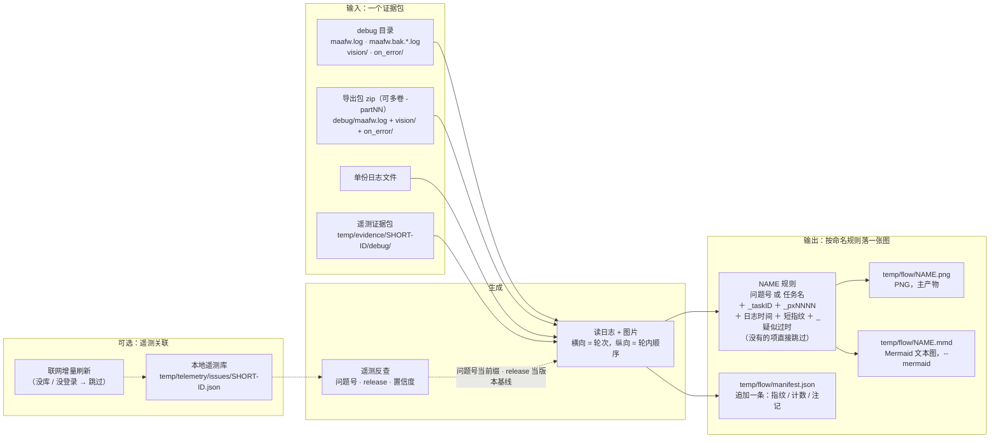
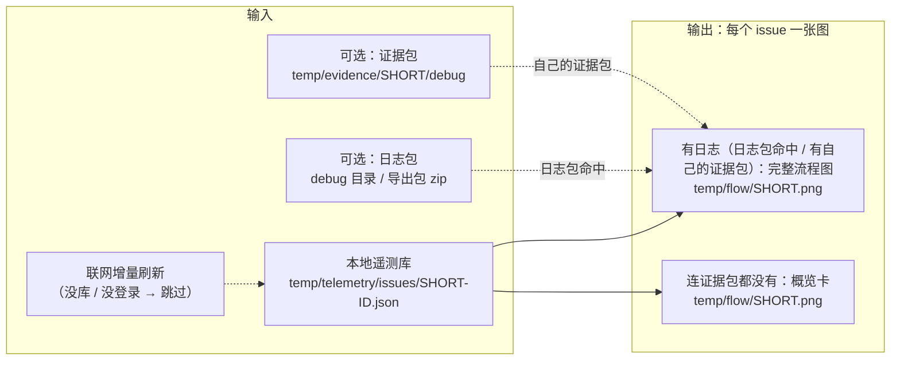

# tools/drawing —— 绘图工具

把**一次运行**的日志（外加可选的识别帧、失败现场图）还原成一张「横向=轮次、纵向=轮内顺序」的图，
回答四个问题：这次跑到第几轮、卡在哪个节点、连续多少次没命中、**每一步是被谁派发出来的**——
最后一项用浅色**分组框**套住同一个派发者连着派发的那几步，框的左上角压一个深色角标写父节点名。
**同一个循环跑很多遍时不必逐轮各占一列**：连续同形、整轮没有截图且没有失败框的轮次会合并成一列，
列头写「第 a–b 轮 · ×N」（`--no-overlay` 关掉）。

它只读本地证据：不联网、不驱动设备、不改日志与图片。产出是给人看的 PNG（`--list` 给纯文本），
统一落到**仓库根的 `temp/flow/`**（`--out` / `--outdir` 可覆盖）。

**边界**（后面「功能取舍」里的每一条都是这条边界的推论）：本工具只画单次执行的**过程**，
不统计多次运行、不判断任务好坏——那是 [`tools/sentry`](../sentry/README.md) 的事；
日志里没记的东西它不会补，也不会猜。

> **改完本目录的脚本要校验并修到全绿才结束**：清单见
> [`tools/validation` 的「改完脚本的验收」](../validation/README.md#改完脚本的验收)（门槛四项 + 本目录两个入口的
> `--help`；改了渲染口径还要按下面「已知坑」bump `RENDERER_VERSION` 并重画一张核对）。

## 功能取舍

| 不做 | 为什么 | 要它怎么办 |
| --- | --- | --- |
| 失败率、趋势、跨版本对比 | 目的只画单次执行顺序；把多次运行混进一张图，图的含义就变了 | `python -m tools.sentry.cli task-failure` / `task-trend` |
| 自己去 Sentry 下载日志与附件 | 画图必须有本地图片；而 Sentry 失败附件跳过 `vision/`、图片包上限 5 MiB，在那边画不出画面格 | `python -m tools.sentry.cli evidence --issue <ID>`：把现场图与那次运行的日志一起拉到 `temp/evidence/<ID>/debug/`，并打印 `flow --case` 命令 |
| 证据包没带 `vision/` 时"补"出画面格 | 只画日志与图片里确实有的东西；没有就留空，不合成 | 让对方手动导出（勾「包含 vision 图片」），把导出包喂 `--case` |
| 从事件总线行取识别/动作明细（`!!!OnEventNotify!!!`、`ctx_event_sink`、`Node.PipelineNode.*`） | 同一次识别在日志里有两行副本，按行计数会翻倍；`reco [result=]` 已经带完整识别明细与 `reco_id` | 手工按行计数时按 `reco_id` 去重（注意它是**进程内**计数，一份装了多次运行的日志里会重复） |
| 从 `Node.PipelineNode.*` 反推父节点 | 它的 `name` 是**派发者**不是刚跑完的节点（实测 117 条里 91 条两者不同），拿它判断"谁跑完了"会记到父节点头上 | 要父节点用 `Node.NextList.*`：那一种事件行是**唯一**给出"谁在派发 + 候选表"的地方，所以单独解析（见「解析口径」）；这也是"不从事件总线取数"这条取舍的唯一例外 |
| 还原被导出截断的行 | 截断的 JSON 猜出来的内容会变成图上的假事实 | 用完整 `maafw.log` / `debug` 目录；工具会统计并提示跳过了多少条 |
| 把 Explore 导出的 CSV 直接当输入 | 导出的正文按块切碎（每格约 3.3 KB、块首块尾丢头去尾），格子顺序也不是时间顺序，直接拼会拼出假行 | 先还原：`python -m tools.sentry.cli explore-csv <csv>`，再拿它产出的 `temp/flow/<csv 名>.log` 来画 |
| 把连续未命中折成一格后仍标注时间跨度 | 框文本经 `fit_text` 截断，先被切掉的正是末尾的数字 | `--collapse 1`：每次识别各占一列，逐列看时间 |
| 加 `--include-attempts` 把失败识别并进 node-done 视图 | 两套记录口径不同：`reco` 行**没有 `task_id`**，并进步骤后既可能混进别的任务（同窗口一起跑的任务），又会和「未命中（聚合）」框画重；"卡住"这件事 `Node.NextList` 的连续 `Failed` 已经能精确说清（见「解析口径」），不需要改步骤来源 | 看图第二行的 `N 轮全未命中` 注记，或 `--list` 末尾的「父节点评估」账；要看逐次识别用 `--from/--to` 圈住那段，它会走"由识别记录还原" |
| 加 `--keep-order` 之类的开关保留原始行序 | 时间戳回跳是数据坏了，按时间重排是修数据而不是风格选择 | 要看原始顺序直接读日志文件 |
| 把"前缀差一步"的两轮当重复折在一起（子序列匹配） | `A,B,C,D,E` 与 `B,C,D,E` 看着是同一个循环，但短的那轮是从中间开始的；硬折会让列头写的轮号区间与实际首尾不符，读图的人会以为第 3 轮也跑了 `A` | 只从列首逐项比。真要看这两轮怎么衔接，用 `--no-overlay` 逐列看 |
| 判断节点"是不是真的过时" | 只能比"日志所属资源版本时的定义"和"现在的定义"有没有差异；先后顺序、字段增删、注释都算不同，而"改动有没有影响这个节点的行为"要读代码 | 图上只标「疑似过时」；终端给出最近一次改动该模块的提交，按它去核对（见「节点"疑似过时"」） |
| 判断"agent 在场但回调抛异常/返回 false" | 框架只在回调**没注册**时打那两条 ERR，注册了却失败不打——日志里没有这个信号 | 看 `debug/agent/agent.log`；图上「agent 缺位」是**单向**证据（见「agent 缺位」） |

判据都写在代码里：`round_steps()`、`compose_columns()`、`describe_empty_window()` 的文档字符串。

## 怎么跑

```bash
# 1. 一段日志 → 执行流程图（本机安装根）
python tools/drawing/flow_from_log.py <安装根>/debug/maafw.log \
    --vision <安装根>/debug/vision \
    --from "2026-10-11 21:39:56" --to "2026-10-11 21:43:29"

# 只解析、不画图（父节点那一行也给全，不折叠候选；末尾附"父节点评估"账）
python tools/drawing/flow_from_log.py <安装根>/debug/maafw.log --task-id 200000013 --list

# 重复轮次：默认把连续同形、整轮无截图且无失败框的轮次并成一列；
# 要逐轮时间就 --no-overlay，要 3 轮起才合就 --overlay-min 3
python tools/drawing/flow_from_log.py <安装根>/debug/maafw.log --no-overlay
python tools/drawing/flow_from_log.py <安装根>/debug/maafw.log --overlay-min 3

# 节点"疑似过时"默认会查（要本地有对应的 git tag，缺就 git fetch --tags）；
# 不想查、或仓库不是 git（只拷了 debug 目录）时用 --no-stale-check
python tools/drawing/flow_from_log.py <安装根>/debug/maafw.log --no-stale-check

# 2. 证据包（debug 目录 / MFA 导出 zip / 多卷 / 单份日志）→ 流程图，带 manifest 幂等
#    产物名优先用遥测问题名（temp/evidence/<SHORT-ID>/ → <SHORT-ID>），其次任务名，见「产物文件名」
python tools/drawing/flow_cases.py --case D:/MaaAshArms/debug --task-id 200000118
python tools/drawing/flow_cases.py --case log_20261014-part01.zip log_20261014-part02.zip --task-id 200000118
python tools/drawing/flow_cases.py --case D:/MaaAshArms/debug --list-cases
#    目录里只有轮转后的 maafw.bak.*.log 也认（取 mtime 最新）；
#    截图/现场图默认取 <case>/vision、<case>/on_error；传单份日志文件时取日志所在目录的那两个
#    子目录，也可用 --vision / --on-error 指定别处；
#    `on_error/` 会递归扫子目录：遥测证据包把每次失败的现场图放在 on_error/<run_id>/，
#    只画某一次就 --on-error <case>/on_error/<run_id>（不指定则按节点名+时间就近匹配）；
#    包里有图、但都不在本窗口（时刻对不上）时，顶部注记会点出文件名与时刻，不硬贴到本次失败上
python tools/drawing/flow_cases.py --case D:/MaaAshArms/debug --vision D:/MaaAshArms/vision --task-id 200000118
#    默认会关联遥测问题（在本地遥测库里反查，联网只补缺的 issue）：
python tools/drawing/flow_cases.py --case D:/MaaAshArms/debug --telemetry-only   # 只反查、不画
python tools/drawing/flow_cases.py --case D:/MaaAshArms/debug --telemetry-offline # 不联网
python tools/drawing/flow_cases.py --case D:/MaaAshArms/debug --no-telemetry      # 纯离线

# 3. 白板图片转 png 并改写引用
python tools/drawing/whiteboard_images.py
python tools/drawing/whiteboard_images.py --check     # 只报告，发现非目标格式即 exit 1
python tools/drawing/whiteboard_images.py --dry-run   # 报告将要做什么，不改动
```

遥测侧的入口是 `python -m tools.sentry.cli flow`，它转发到 `flow_cases.py`，产出目录一致。

### 输入输出工作流

一个证据包进、一张图出。虚线是**可选**的遥测关联（`--telemetry`，默认开）：只影响文件名前缀、
注记和「疑似过时」的版本基线，没有它照样出图。



`NAME` 的优先级（问题号 → 任务名 → 目录名）与附加项的出现条件，见下面「产物文件名（`flow_cases.py`）」一节。

默认一个证据包出一张图；加 `--all-tasks` 时按任务各自反查遥测、各出一张（文件名 stem 换成各自的问题号），
产物仍是 `temp/flow/NAME.png` + `.mmd` + 同一条 `manifest.json` 账目。

### 批量出图（遥测库驱动）

以**整个本地遥测库**（所有未解决 issue）为驱动，一次出一批图。每个 issue 尽量出**完整流程图**：
日志包命中的按任务出；没命中的用该 issue 自己的证据包日志出；连证据包都没有才退概览卡。



- **给了日志包**：先把日志里的失败在库里反查，**命中的 issue 按任务各出一张完整流程**
  （与 `--all-tasks` 同一个画法，文件名用问题号）。
- **没命中日志包的 issue**：用该 issue **自己的证据包**（`temp/evidence/<SHORT>/debug/` 里的
  `maafw.log` 尾部 + `on_error/`）画**完整流程图**——证据包就是那次运行的日志，不是"预览"。
  **本地没有就自动调 `evidence` 拉取**（默认开，需联网）；`--no-fetch-evidence` 关掉，
  `--telemetry-offline` 时也不拉。
- **只画失败的那个 task**：证据包尾部常连着同一次运行的多个 task
  （Train → Escort → Battle → Training），整段画会把它们接成一条链。定位顺序是
  `failure_task_id`（在日志里才用）→ 失败节点所在的 task → 任务入口名；都定位不到、
  且日志里多于一个 task 时退概览卡，不混画。
- **终端是 `BaseTaskStopError` 时按上游派发者分桶**：文件名带 `BaseErrorNext` 的派发者与 task，
  例如 `PYTHON-2H_EscortEnterHome_task200000004.png`——同一个 issue 的不同运行/任务上游不同，
  各成一张、互不覆盖。历史上不同运行用 `evidence --issue <ID> --event <id>` 分别取（见 sentry README）。
- **连证据包都没有**才退化成**概览卡**（问题号 / 标题 / 失败节点 / 次数 / 最后出现 / 资源版本 / 链接，
  有 `on_error/` 时贴现场图），并在卡上写明用哪条命令补完整输出。
- 产物：每个 issue 一张 `temp/flow/<SHORT>.png`（`--mermaid` 另出 `.mmd`），同样记进
  `manifest.json`（与单包出图同目录、同账目）。

```bash
# 只画遥测库里所有未解决 issue：有证据包/日志包的出完整流程，没有的出概览卡
python tools/drawing/flow_cases.py --telemetry-bulk

# 同一份日志包；缺失的证据包会自动拉取（默认开，需联网）
python tools/drawing/flow_cases.py --telemetry-bulk --case <证据包>

# 离线：不拉证据包，缺失的只出概览卡
python tools/drawing/flow_cases.py --telemetry-bulk --case <证据包> --telemetry-offline
```

### 日志（`--log-level` / `--log-file`）

`flow_cases.py`、`flow_from_log.py`、`telemetry_index.py`（也就是 `tools.sentry.cli telemetry`）
都支持：

- 每次运行在 `temp/logs/` 下按运行时间戳建一个日志文件
  （`<tool>_<YYYYMMDD-HHMMSS>_<pid>.log`），带时间戳与级别，**独立于**
  `temp/flow/`（图）和 `temp/telemetry/`（遥测库）；
- 控制台仍只走 **stderr**，stdout 留给机器可读的结果（清单 / 匹配列表 / 报告）；
- `--log-level DEBUG|INFO|WARNING|ERROR` 过滤级别；`--log-file <路径>` 改路径，
  传 `none` 只走控制台、不写文件。

同一进程里多个模块（如 `flow_cases` 调 `flow_from_log`）的日志会进同一个文件，
记录前缀是各自的 `[tools.<模块>]`。

### 解析口径（读图前先看这里）

- **父节点 = 本轮的派发者，不是配置里的层级**（图上是一个**浅色分组框 + 左上角深色角标**）：
  来源是 `Node.NextList.Starting/Succeeded/Failed` 事件（`name` = 正在评估 next 表的节点、`list` = 那一刻
  排着的候选、`jump_back` 标出 `[JumpBack]`）。`next` 是**有序候选集**，同一节点可以被多处派发、
  `[JumpBack]` 会弹回上层，所以这是**调用图不是树**；同一个父节点会在图里反复出现，别按层级读。
  - **套框规则**：同一轮里**连续**由一个父节点派发的那几步套一个浅色框，框的左上角压一个深色实心角标
    （白字）写父节点名。父节点换了就另起一个框；同一个父节点跨轮重复出现就是各自独立的框
    （实测 task 200000054：4 轮里共 10 个框，`TrainingEnterOne` 一个框含 `BaseMoveUp` + `TrainingEnterFormation`）。
  - **配色**：同名父节点永远同一套颜色（一眼看出"又是它派发的"），不同父节点按**首次出现顺序**轮换
    `PARENT_COLORS` 里的 6 套（蓝 / 青绿 / 琥珀 / 紫 / 绿 / 玫红，都是浅底 + 同色系边框 + 深色角标）。
    超过 6 个父节点就循环取色，此时靠角标文字区分。
  - **不入框的三种**：任务起止框（`kind == "task"`）、`父 未记录`（没归上派发者）、**自派发/自循环**
    （父节点就是自己）——第三种在图上是那个"循环节拍"节点自己：它派发别人（它开头标着角标的框），
    别人弹回它，所以它夹在框之间。
  - 框里那一行 `候选：…`：带 `√` 的是**本次真跑的那个**（按候选表里的位置认，重名时只标第一个），
    带 `弹回` 的是 `[JumpBack]` 候选，`另 N 项` 表示还有几个候选没列出来（框里只列
    `PARENT_CHOICE_LIMIT` 个，`--list` 给全）。派发者名字已经在角标里，所以这一行不再重复写它。
  - `父 X（自派发/自循环）`：`list` 里含自己。**入口那一轮是框架合成的自派发**
    （`TaskTraining -> [TaskTraining]`），与"配置里写的自循环"（`BattleWin -> […, BattleWin, …]`）
    在日志里长得一样，工具不猜是哪种。
  - 三种退回依次是 `Node.NextList` → `[cur_node_=X]`（只知道派发者、不知道候选表）→ 该 task 的入口名，
    都不成立才是 `父 未记录`；超时/`node not completed` 这类失败事件按**它自己报的节点名**去查表
    （没有被选中进候选表的 `Task timeout` pretask 查不到，属正常）。
  - **整张图一条候选都没有时**（日志里没有 `Node.NextList`，例如只导出到某一段）：不逐个框写"父 未记录"，
    只在图上第二行注记一次；`--no-parents` 关掉分组框与那一行（图会矮一截）。`--list` 始终打印候选，不折叠。
- **"卡在派发层"要点名**（图第二行 + `--list` 末尾的「父节点评估」账）：`Node.NextList` 分三种事件——
  `Starting`（开始评估）、`Succeeded`（有候选命中）、`Failed`（整张候选表一个都没命中）。**同一条候选表
  连续 `Failed` 就是"任务一直重试候选、没有任何子节点跑起来"的直接证据**，而 `reco` 行不带 `task_id`，
  这是唯一能说清那段时间在干什么的数据。
  - 图上的注记形如「`TaskReplays` 的候选表 13 轮全未命中（候选 `ReplaysInit ・ …`），跑起来的候选：`LoopErrorByTimes`」；
    只报 `Failed ≥ 2` 的派发者（1 轮无命中是循环推进的正常现象），最多两条，且只在"图只涉及一个 task"时报。
  - `--list` 末尾追加 `--- 父节点评估（Node.NextList）---`：按派发者列出 `未命中 N 轮 / 开始 N / 命中 N`
    与**真实候选表**（取全未命中那一轮的 `list`——入口轮是 `[自己]` 的自派发，不能当候选表）。
  - 实测（`PYTHON-J`，task 200000167）：只有 2 条 `PipelineTask node done`，但 `TaskReplays` 的候选表
    **13 轮全未命中**、`LoopErrorByTimes` 随后 → `BaseTaskStopError`——旧版图只看得到末尾两步。
- **重复轮次合并成一列**（`--no-overlay` 关闭，`--overlay-min` 调阈值，默认连续 2 轮）：日志里"同一个循环跑几十遍"
  很常见（实测一份 40 轮的日志里 34 轮是同形的两步：`ReturnBattleMainPage → BattleInHome`，每轮都没截图），
  逐轮各占一列会让图宽到没法读。合并条件四条**同时**成立，任一条不满足就在那里断开（不是整段作废）：
  1. **签名相同**：`(节点名, 种类, 折叠次数, 是否完成)` 逐项从**列首**对齐。种类含 `未命中（聚合）`，
     所以「`B,C,D,E`」与「`B,C,D,E` + `未命中 ×5`」是两种形状；`×3` 的一格也不等于逐次三格。
  2. **连续**：中间夹一轮别的形状就断成两段。
  3. **整轮无贴图**：`--vision` / `--on-error` 一条都没贴上才算（有图本身就是信息）。
  4. **整轮无失败框**：`node not completed` / `Task timeout` / `invalid node id` 一律不折——折进 `×N` 等于把"这次崩了"藏起来。
  - 合并列画**首轮**的步骤（时间戳是真实的，不复制、不改 `Step`），列头写
    「第 a–b 轮 · ×N 重复 · 首轮起–末轮止」，底色转琥珀、右侧一根橙竖条；末端那列若也有失败框，会各自独立成一列。
  - 图上第二行写「N 段重复已合并 → M 列」，图例末尾多一项「合并列」。
  - **判定发生在贴图解析之后**，所以 `--no-thumbs` 时所有轮都算"无图"（这个开关本来就不看贴图），
    与"证据包里没有图片"是同一个结果。
  - `--no-overlay` 的产物与加这个功能之前**逐字节相同**（实测 sha256 一致），要逐轮时间就关掉它。
- **按时间重排**：日志时间戳回跳时（Explore 导出的 CSV 是分块拼接的）先按时间戳稳定排序再解析，
  图上印一行「日志时间戳有回跳，已按时间重排（N 行）」。不再有"遇到第一条晚于 `--to` 的行就停"这一步——
  它会把窗口内的记录整段丢掉，还报成"窗口内没有记录"。
- **仅事件模式**：日志里没有 `PipelineTask node done`（Sentry 导出就是这种）时，用识别记录
  （`reco [result=]`）合成步骤，图上印「由识别记录还原」。此时默认按 `--collapse` 把连续同节点的
  识别折成一格（`未命中 ×13`）；`--collapse 1` 保留每次识别各占一列。`reco` 行里没有 `task_id`，
  能取到该 task 的起始行就夹住范围，取不到会印一行提示。
- **`--task-id` 严格过滤 + 任务判定窗口**：`steps` 与事件都按 `task_id` 过滤；框架级事件
  （`Task timeout` / `invalid node id` / `node not completed`，没有 `task_id`）改用**判定窗口**
  归属——下界是本任务第一步，上界优先取**它自己的 `task end`**（任务失败后框架不再为它记东西），
  没有 `task end` 时退回"本任务最后一步之后、别的任务的第一步"。未命中聚合（`reco` 行同样没有
  `task_id`）用同一个窗口。这样一份装了多次运行的日志不会把 23:59 那趟训练的未命中画进 13:11 那趟维修的末轮，
  也不会把同一运行里后一个任务的超时画进前一个任务的图上；而"最后一步之后"的失败标记仍留在图上
  （任务失败恰恰发生在最后一步之后）。被排掉的条数会印出来。
- **任务号在各进程内复用，`--task-id` 要配 `--pid`**：MFA 每次启动都从同一个基数重新分配任务号
  （本机 `maafw.log` 里 `200000001` 同时出现在 `Px15316`（18:01）与 `Px6448`（20:40）两次运行下）。
  只给 `--task-id` 会把这几次混成一张图——**步骤数对不上就是它**。先 `--list-tasks` 看清单：

  ```powershell
  python tools/drawing/flow_from_log.py <安装根>/debug/maafw.log --list-tasks
  # 进程      task_id  步数  开始                    结束                    入口
  # Px15316  200000001     1  2026-10-27 18:01:14.527 2026-10-27 18:01:15.337 @mse/action
  # Px6448   200000001     5  2026-10-27 20:40:35.535 2026-10-27 20:40:56.080 TaskEscort
  ```

  再 `--pid Px6448 --task-id 200000001`。不给 `--pid` 时保持旧行为（只按编号切，全文混合）。
  `--list-tasks` 只列有节点执行的任务；`MaaTaskerPostStop` 那种 0 步的停止指令不列。
  `flow_cases.py` 也接受 `--pid`（透传给 `FlowOptions.px`），产物名会带上 `_px<进程>`：
  实测 `maafw.bak.2026.11.02-08.57.51.341.log` 里 `200000003` 同时属于 `Px12748` 与 `Px3352`，
  不给 `--pid` 是 16 步、给 `--pid Px3352` 是 9 步。
- **诊断注记**：由上面这些事实构成的注记印在图第二行，**一条一行、按类型上色**并同时打到 stderr。
  绿 = 这次用的资源版本；琥珀 = 疑似过时 / 记录被裁断；红 = agent 缺位；蓝 = 由识别记录还原；紫 = 时间戳回跳；灰 = 其他前提。

### 节点"疑似过时"（默认开，`--no-stale-check` 关闭）

`evidence`/`flow` 拉的是**当时**的日志。图照常产出，但那些节点在新版本里可能早已被改名、删除或改了字段——
读图的人如果不核对，就会拿一张过时的图去解释当前代码。所以渲染时顺手比一次：

1. **版本**：只取 **`资源版本：vX.Y.Z`**（MFA 自己报的，与资源包对得上）。
   **不看安装目录名**：正常安装目录本来就不带版本；带了也只是装机时的名字，更新资源后就是错的——
   实测同一份日志目录名 `beta.42`、资源版本 `beta.58`（2026-11-02 用户反馈），拿目录名当基线会把
   基线整体前移、多标一堆"疑似过时"。判出来的版本会作为一条绿色注记写在图顶部。
   来源三处，按顺序找：
   - **日志自己**（取最后一条——同一份日志里可能先后两个版本，如 `log-20261102.log` 的
     `08:38:15 beta.58` 与 `08:38:54 beta.61`）；
   - 日志里没有（原生 `debug/maafw.log` 就是这种，那行是 MFAAvalonia 写的）→ 去**同装
     `logs/log-*.log`** 借，按"这段内容的末尾时刻"挑那一刻生效的那条，注记标明
     「取自 MFA 日志 logs/log-*.log」；
   - 都没有 → **遥测证据包**会从 `evidence.json` 的 `event.release`（Sentry 事件字段，
     形如 `MFA@v2.16.1+MaaAshArms@v1.0.0-beta.61`）取资源版本，注记标明
     「取自遥测证据包 evidence.json 的 release」。这条是 `flow --case temp/evidence/<问题号>/debug`
     的主路径——原生 maafw.log 没有「资源版本」那行，同装 MFA 界面日志也不会被 `evidence` 下载，
     所以只能靠遥测自己报的 release 兜底。
   三处都没有就不做这项检查，注记写明原因（遥测附件只带日志尾部、且 `evidence.json` 没记到 release 时，
   实测 `PYTHON-25`/`28`/`2F`/`2G` 里取不到）。
2. **节点所在模块**：读当前 `assets/resource/pipeline/*.json` 的顶层 key。找不到 → 记进"已被改名或删除"
   那条注记（这是事实，不是推测；例如 `TrainClickArrow` / `TrainEnsureHome` / `TrainEnsureInfo`）。
3. **比定义**：`git show <tag>:<pipeline 文件>` 取那个版本的定义，与当前定义逐字段比（按键排序，
   避免键顺序造成假差异）。**不同 → 节点名后标「疑似过时」**；图上注记写 `模块@短hash`，
   终端那条把"最近一次改动该模块的提交"写全。定义一字未动的节点不标。

**只标疑似，不判断是否真的过时**：边界先后、字段增删、注释都算"不同"，到底有没有影响这个节点的行为要人核对。

命中时**画完图后会额外打一段**（`flow_from_log.py` 与 `flow_cases.py` 都打，走 stdout，与产物路径挨着）：

```text
疑似过时：2 个节点在资源版本 v1.0.0-beta.58 之后改过——图里这些节点名带「疑似过时」，改动有没有影响它们的行为要自己核对
  BaseReturnHome（base.json，最新 8c97bf6 2026-10-28T12:08:20+08:00 refactor: 重构 base 模块，使其符合 v3.0 规范）
  TaskTrain（train.json，最新 b39d5cd 2026-10-31T15:12:02+08:00 chore: 更新重构后的过时注释）
```

`flow_cases.py` 还会把这个后缀写进文件名（`_疑似过时`）。图上第二行的注记只给
"几个、哪几个、`模块@短hash`"，完整提交信息在终端那一段里。

几个刻意的选择：

- **按节点定义比，不按"文件有没有提交"**：前者把整个文件和它所有节点一起标上（实测 `beta.42` 之后
  `train.json` 有 6 次提交，42 个节点里 38 个被标，等于没标）；也**不按"名字有没有出现在 diff 里"**——
  `dec9686` 重写 `feidu_gift.json` 时 47 个名字全在增删行里，但其中 4 个节点定义一字未改。
- **版本之后才新增的节点不标**：那时它还不存在，谈不上"过时"。
- **tag 必须在本地**：`git fetch --tags` 之后再跑；缺 tag 时注记会直说，不当成"没有过时节点"。
- **开销**：一次 `git show` 每模块 + 带缓存的 `git log -1` 每模块，一份 42 节点 4 轮的日志多约 4 s
  （1.5 s → 5.7 s，其中大部分是画图本身）。嫌慢就 `--no-stale-check`。

### 关联遥测问题（`--telemetry`，默认开）

画本地包时顺手在**本地遥测库**里反查这个包对应哪个线上问题
（库怎么建、怎么清理见 [`tools/sentry` 的「`telemetry`：本地遥测库与反查」](../sentry/README.md#telemetry本地遥测库与反查画图默认开)）。查到后：

- 图上注记**最前面**加两行：`遥测问题 PYTHON-2X：12 次 · 最后 11-03 08:52 · v1.0.0-beta.61`、
  `遥测失败：Maa task failed: Escort (BaseTaskStopError/action)`；
- 产物文件名前缀用问题号（`PYTHON-2X_TaskEscort_task200001359_px33560.png`），比目录名可靠；
- 拿它的 `release` 当「疑似过时」基线（省掉"日志里没有资源版本"那次跳过）。

| 开关 | 作用 |
| --- | --- |
| 默认 | 联网刷新本地库（只补新增/`lastSeen` 变了的 issue），再在本地查 |
| `--telemetry-offline` | 只读本地库，不联网 |
| `--no-telemetry` | 完全不做这层关联 |
| `--telemetry-issue PYTHON-2X` | 指定问题号，不自动反查 |
| `--telemetry-only` | 只打印候选问题，不画图 |

**反查给候选、不给唯一答案**：一次运行常有多个失败事件，同一个包可能对应好几个 issue。
只有"恰好一个 `task_id` + `node_id` 全等"时才自动采用，否则取时间最近的并打提示。
刷新失败（没装 `sentry` CLI / 没登录）只提示一次，照常画图。

### agent 缺位（自动标，没有开关）

日志里出现下面任意一条 ERR，就说明框架引用了 Custom 回调名、但**没有任何进程注册它**：

| 来源 | 行 |
| --- | --- |
| `CustomRecognition.cpp` `L33` | `recognition is null [name_=<节点>] [param_.name=<Reco 名>]` |
| `CustomAction.cpp` `L19` | `Action is null [node_name=<节点>] [param.name=<Act 名>]` |

只在 agent 缺位时出现，所以是硬证据。命中的两条按"ERR 在前"挂到受影响的记录上：

| 缺位类型 | 图上表现 |
| --- | --- |
| 识别未注册 | 那条 `algorithm=Custom`、`box=null` 的记录标 `agent 缺位`（实测 ERR 之后约 30 ms），通常并进「未命中（聚合）」框 |
| 动作未注册 | 那一步（`completed=false`）的 detail 后标 `agent 缺位`（实测 `EntrustInit` 之后约 200 ms） |

标题注记给"多少处、哪些节点"；全部命中都落在同一段缺位区间时，再补一句区间
（`MaaAgentClientDestroy` 之后没有 `MaaAgentClientConnect` 返回，就是"销毁了却没重连"）。

**反向不成立（也印在图的注记里）**：没有 `agent 缺位` 标记**不代表** agent 在场——回调注册了但抛异常
或返回 false 时框架**不打**这两条 ERR（源码 `CustomAction.cpp:18-21`、`CustomRecognition.cpp:32-35`
只在回调指针为空时打），那种情况只有 `debug/agent/agent.log` 能说清。

三个**不要**当成 agent 缺位的反例：

1. 只有 `[pretask.reco_timeout=…]`、一个 Custom 参数都没有 → 纯识别超时；
2. agent 在场但回调自己返回 `false` → 就是上面那条反向情形，不打 ERR；
3. `failed to get_reco_result [reco_id=…]`（`MaaTasker.cpp:359`）单独出现 → 多份日志里成百条地出现，
   噪声太大，只能当辅证。

实现上的两个坑（都写在代码注释里）：`name_` 是**节点名**而不是注册名（已与 pipeline 的
`custom_recognition` 对照），所以归属不用绕注册名；`clear_custom_registration` **不是**断开信号，
它是每次 `MaaAgentClientConnect` 的准备工作（本机实测 23 次入口对应 22 次 Connect），拿它当"断开"会误报。

### 失败框（`动作失败` / `动作未派发` / `node not completed` / `Task timeout`）

图上红色框有四种来源，按**时间戳**插进轮内（不是一律缀在列末）：

| 框 | 来自 | 说明 |
| --- | --- | --- |
| `动作失败 <动作名>` | `Node.Action.Failed` 的 `action_details.action` | 动作派发了但返回 `success=false` |
| `动作未派发` | 同上，但 `action` 为空、`action_details.action_id=0` | 动作根本没派发（常见于识别给了零矩形、或任务正在停止） |
| `node not completed` | `PipelineTask.cpp` | 框架级收尾，**比上两条晚**（实测 0.2 s / 3.4 s） |
| `Task timeout` / `invalid node id` | 框架 | 同属框架级收尾 |

`Node.Action.Failed` 与 `node not completed` 对应**相反**的排查方向（动作/坐标 vs 识别/ROI），
所以前者不再被后者吞掉。同一事件日志里会出现两条（MFA 进程与 agent 进程各发一次通知，相差 1 ms），
按 `(节点, task, action_id, 动作名)` + 1 s 窗口去重，图上只画一个。

命中框里也会标出"动作没派发"（`detail()` 里 `action` 为空时原本整段跳过，失败一点痕迹不留）：
`GiftChooseFirstGift` 那种 `action=""`、`action_id=0` 的步骤现在显示 `动作未派发`。

**`BaseTaskStopError` 的失败是设计如此**：`BaseTaskStopErrorAct` 恒返回 `false`（`agent/shared/generic.py:124`），
用来让任务报错结束。所以它那个 `动作失败 Custom` 框是**正常收尾**，不是动作坏了。

### 缩略图角标：哪张才是失败现场

一次失败里大部分框贴的是**识别帧**（`debug/vision/`），同一次卡住的十几步往往是同一个画面的截图，
看起来一模一样；只有 `debug/on_error/` 那几张才是**失败那一刻**的现场。两者必须能一眼分开：

| 角标 | 图来自 | 画法 |
| --- | --- | --- |
| `失败现场 HH:MM:SS.mmm` | `on_error/<时间>_<节点>.png` | **红框 + 实心红底白字**角标；时刻就是文件名里那一段，直接对上 `debug/on_error/<文件>` |
| `邻近帧` | `vision/` 里**别的节点**的帧（本节点没存图时的最近帧） | 淡琥珀小字，不抢眼 |
| （无角标） | `vision/` 里本节点自己的识别帧（`reco_id` 精确命中） | 就是"这个节点当时看到了什么" |

顶部注记还会点名本窗口内的现场图文件名（`提示：失败现场图：2026.11.03-08.52.54.334_BaseTaskStopError.png`），
同名节点一天失败好几次时以它为准。

失败现场图贴回同名命中节点有两条硬限制（`backfill_failure_thumbs()`）：

- **时间上限 8 s**：`on_error/` 是"这一步失败时"抓的，隔几分钟的是另一次失败。实测同一个
  `BaseTaskStopError` 一小时里失败 4 次（08:50 / 08:52 / 09:02 / 09:03），不设上限时按列表顺序
  覆盖 → 最后遍历到的 09:03 那张赢，本次失败框就贴着别的跑次的图。
- **一格只留最近那张，且不覆盖该节点自己的精确识别帧**。

### 画不出来时的报错

`--from/--to/--task-id` 写错、路径写错、窗口落在日志时间范围外，报的话各不相同，且都会报出
**看到了什么**（行数、日志的时间范围、被过滤掉的是哪一类）：

```text
错误：入参像路径但磁盘上没有这个文件：D:/MaaAshArms/debug/vision；它也不含任何一行日志正文
错误：窗口内没有日志行：日志时间范围 2026-10-13 14:52:37.678 ~ 2026-10-14 00:35:24.413；请求的窗口 2027-01-01 00:00:00.000 ~ 2027-01-01 01:00:00.000
错误：窗口内 20 行里属于本 task（--task-id=999999）的节点级记录一条都没有，有 1 行是其他 task_id 的
```

## 三个脚本的分工

| 文件 | 角色 |
| --- | --- |
| `flow_from_log.py` | **渲染器**：解析 + 布局，唯一定义处。也能 `import` 调用 —— `render_flow(log, vision=…, on_error=…, out=…, options=FlowOptions(…))` 返回 `FlowResult` |
| `flow_cases.py` | **编排**：找证据、跑批量、写 `temp/flow/manifest.json`、幂等跳过。**不复制渲染逻辑** |
| `whiteboard_images.py` | 白板体系的图片格式统一（见 `.agents/canvas.md`） |

`flow_from_log.py` 的日志入参接受**路径（含 `pathlib.Path`）/ 正文 / 文本流**三种；图片证据接受目录、zip、
多卷 zip、内存字节，都经 `MediaResolver`（zip 里的图**延迟解压**，避免整包读进内存）。

`FlowResult` 里有 `truncated_start`（日志只剩尾部）、`notes`（与图上第二行同一批注记，元素是
`Note(text, kind)`，`kind` 决定图上颜色）、
`derived_from`（非空 = 步骤由识别记录合成）、`out_of_order`（回跳行数）、`stale`（疑似过时的节点清单，
`None` = 没做这项检查）——库调用方不用去猜图是按什么口径画的。

## 依赖与前置

- **Pillow**：画图要它，而**发布包自带的解释器不含 Pillow**（`.python-runtime/` 与包内
  `python/` 都 `import PIL` 失败）。用装了 Pillow 的系统 Python 跑；绘图不进发布包。
- 无 Pillow 时 `import` 仍可用（Pillow 只在画图、加载字体时才惰性导入），只有真画图会报"需要 Pillow"。

## 已知坑

- **产出目录靠上溯级数算**：`REPO_ROOT` 是 `tools/drawing/` 上溯两级。再改目录层级必须同步改，
  否则图会静默落到 `tools/drawing/temp/flow/`。`check_python.py` 的 `repo-root` 检查拦这个。
- **`--no-thumbs` 只影响"贴不贴图"，不改变框高**（`slot_h` 与 `thumbs` 无关，
  `box_height_for` 只看该框有没有图）。别拿产物尺寸判断贴图是否生效——用 sha256 或直接看图。
- **贴图失败会打警告，但有上限**：一次几百张图读不了时只打前 5 条 + 一条汇总。读不出来的
  常见原因是分卷缺卷、或图片已被框架的 7 天清理删掉。接住的是一组"字节坏了"的异常：
  `OSError`（含 `PIL.UnidentifiedImageError` 与图片数据截断）、`ValueError`（偏移为负）、
  `zipfile.BadZipFile`（坏 CRC）、`zlib.error`（deflate 流坏）、`EOFError`（压缩流比记录的短）。
  后三个不是 `OSError` 子类，漏一个就会让一张坏图把整张图掀掉。
- **同时间戳的 vision 图要给 `sort` 加次键**：文件名毫秒段位数不固定（`.51` 与 `.510` 解析成同一个
  `datetime`），同一时刻有多张图时，`VisionIndex` 里裸 `list.sort()` 会继续比较 `MediaEntry` 抛
  `TypeError`（实测 37803 张里有 26 组）。两处 `sort` 都用 `key=lambda …: (…, entry.member)`，
  `find()` 是线性扫取第一个进 tol 的，所以次键只决定"同时间戳时哪张胜出"，给个稳定顺序就够。
- **副标题里不要用 `⚠`**：msyh 没有该字形，会画成方框。同一类坑实测还有 `✓`、`↩`、`▶`、`☑`、`↺`：
  都会画成方框（`getbbox` 看着有值也照样是方框）。候选那一行用的是 `√` 与"弹回"两个字。
- **分组框与角标是在框/连线之前画的**，它们只是背景；角标不透明且压在第一格左上，所以那一格的上边框
  入口会从角标**右边**的中点进（`in_port()` 里 `badge_boxes` 那段），否则箭头看着像被角标切断。
- **候选那一行比明细小一档（`font_size - 5`）**：实测最长的组合 `父 BattleWinSuccess：√TrainingBattleWin`
  在 13px 下要 255px，而带图槽的框只有 216px 可写；11px 下 219px 刚好放得下（现在角标接管了派发者名字，
  这一行只剩 `候选：…`，更宽松）。缩略图那张图槽只占右半边，所以这一行是从图槽左边过字的（与明细行一样），
  量宽度时用 `row_w` 而不是 `text_w`。
- **分组框要预留净增高**（`column_geo()`）：角标画在"第一格上边界的上方"，而上一格与本格之间只有十几像素，
  所以每组要预留 `group_extra_one = 角标高 + 2×内边距 + group_gap`——**不预留角标会压住上一格的文字**
  （踩过：`column_geo` 只留了角标高 + 内边距，角标吃掉上一格的下半行）。
  相邻两组之间另留 `group_gap_between`（26px）：上一组的框底自带 `group_pad` 内边距，只留 `group_gap`
  会让两个分组框贴到一起。组内相邻两步的间隔收成 `group_gap`（12px），否则默认 36px 叠上内边距太空。
- **一份日志装了多次运行是常态**：`reco_id` / `action_id` 是**进程内**计数，派发者
  （`[cur_node_=X]`）也按进程分开记，所以同一份 `maafw.log` 里的多次运行不会互相串台；
  判"哪一次"用 `--task-id` + `--from/--to`。Explore CSV 还原出来的日志天然跨多次运行
  （实测两个进程、三个任务），画图时必须给 `--task-id`。
- **父节点的归属按 `task_id` 而不是按进程**：`Node.NextList` 事件由 MFA 进程发出（带 `task_id`）、
  `PipelineTask node done` 由 agent 进程写（带 `[task_id_=N]`），两者天然不同进程，按进程匹配会一条都对不上。
  只有 agent 进程那种 `[message=Node.NextList.X] [details_json={…}]` 形态**没有 `name` 与 `task_id`**
  （实测 16 条全是这样），判不了父节点，工具直接跳过它而不是猜。
- **同一份日志里可能一条 `task start:` 都没有**（实测 Sentry 拉回来的 PYTHON-16 只有 `task end:`），
  所以"解析到某一行时正在跑哪个 task"是以最近一条 `node done` 为准的；只有入口名退回会因此落空。
- **日志只剩尾巴时图上会写"注意：日志仅含尾部"**：遥测附件只带 `maafw.log` 的 512 KB 尾部，
  没有这行标注的话读图的人会以为任务从日志第一行开始。
- **整份日志会读进内存**：为检测时间回跳必须读完（本机 10.9 MB 的 `maafw.log` 约 2.4 s、十几 MB 内存）。
  框架自己会轮转日志（`debug/` 下有 `maafw.bak.<日期>.log`），不需要为它做流式裁剪。
- **`RENDERER_VERSION`**：改动会影响产物内容时（版面、注记、解析口径）必须 +1，
  否则 `flow_cases` 会命中旧的 `manifest.json` 直接"跳过（已画过）"，渲染改了却不重画。现在是 **11**。
- **合并与贴图解析的先后**：`overlay_repeats()` 的 `has_thumb` 问的是"第 i 轮实际贴到图没有"，
  所以只能在 `thumb_of` 算完之后调用；按"传没传 `--vision`"提前判断会把其实有图的轮折掉。
  折叠后 `thumb_of` 的键（旧列索引）必须重排，否则 `--no-thumbs` 与 on_error 回贴会把图贴到别的列。
- **合并列的列头要留角标走廊**：父节点角标压在第一格左上，首格若开着一组却没预留走廊，角标会盖住
  「第 a–b 轮 · ×N」——合并列的身份信息全在列头里。只有合并列补这段预留，非合并列维持原样，
  这是 `--no-overlay` 仍能逐字节还原旧图的前提。
- **一份证据包里的日志常覆盖整次运行**（多个任务）：`evidence` 拉下来的 `maafw.log` 就是这样，
  必须配 `--task-id`；同一条 trace 上的多个 issue 会共用同一份日志。

### 产物文件名（`flow_cases.py`）

`<问题名或任务名>[_task<id>][_px<进程>][_<日志时间>][_<短指纹>][_疑似过时].png`，优先级：

1. **遥测问题名**：证据包目录名就是 issue 的 `short_id`（`temp/evidence/PYTHON-1Z/` → `PYTHON-1Z`）；
   `--case` 指到 `debug/` 那层时往上找一层，归档来源看文件名（`PYTHON-1Z-part01.zip` → `PYTHON-1Z`）。
   认不出的目录名（`20261019`、`debug`）不算问题名。

   **问题一旦关联上遥测，就按遥测的命名规则走**：`--telemetry` 反查命中、或 `--telemetry-issue`
   指定后，前缀直接是 issue 的 `short_id`，与 `temp/evidence/<SHORT-ID>/` 同一套，不再回落到
   目录名/任务名。`--all-tasks` 时**每个任务各自反查**（只认该 task 自己的 `task_id`），
   所以同一次运行里的两张图可能带不同的问题号——那是真事，不是名字串了。
2. **任务名**：日志里 `Tasker.Task.*` 事件的 `entry`（`TaskTrain` 这种）。给了 `--task-id` 时只认那个
   task 的 `PipelineTask node done [...] [task_id_=N]` 行，取其中的入口型节点名（`Task*` 开头）。
3. **证据包目录名**：前两者都没有时的兜底。

同名处理（任一条命中就追加日志时间 `_20261024155229`，即 `--from`/`--to` 或日志第一行的时间戳）：

- 磁盘上已有同名文件、且不是本工具画的（manifest 里没登记）；
- manifest 里同名条目登记的是**另一份**日志（日志指纹不同）。

时间标签也冲突时再追加日志短指纹（`_6d990a8f6cdf66b6`），保证结果确定、不覆盖别人的产物。
同一份日志 + 同一套参数仍落在原名上，manifest 幂等不变。

**文件名不再带 `flow_` 前缀**（v10）：产物本来就在 `temp/flow/` 下，前缀只是重复。旧产物
（`temp/flow/flow_*.png`）不会被自动改名或删除，需要的话自己清一遍。

**「疑似过时」命中时，`_疑似过时` 追加在文件名最末尾**（扩展名之前）：`X.png` → `X_疑似过时.png`，
带时间标签时是 `X_20261024-031849_疑似过时.png`。后缀用中文，文件名本身就写清这是哪一类产物。
这个后缀**只能等画完才知道**（检查要拿到日志里实际跑过的节点名），所以是渲染后 `os.replace` 改名，
`.mmd` 跟着一起改；幂等检查同时认 `X.png` 与 `X_疑似过时.png` 两种名字。

**`--all-tasks`：按任务逐个输出，一个 `(进程, task_id)` 一张图。** 不加这个参数时整份日志混画一张
（跨多次运行的任务会叠在一起）；加了之后先 `scan_tasks()` 扫出所有任务，再逐任务渲染，
文件名带 `_task<id>_px<进程>`：

```powershell
python tools/drawing/flow_cases.py --case D:/MaaAshArms/debug --all-tasks
# temp/flow/TaskTrain_task200000030_px30992.png          ← 遥测没匹配上时用任务名
# temp/flow/PYTHON-1Z_task200000001_px15316.png           ← 匹配上就用问题号（遥测命名规则）
# temp/flow/PYTHON-2H_task200000001_px6448.png            ← 同号不同进程，各画各的
```

`task_id` 在每个进程里从同一个基数重新分配，所以文件名的进程号是**唯一性的一部分**，不是装饰。

**带 `--task-id` 时文件名只写 `_task<id>`、不写任务名**：一个 issue 里常有多个任务失败（实测
`PYTHON-1Z` 有 6 个），而那个 task 的入口行不一定在导出的那一段里（实测 200000007 只留下 `BaseReturnHome`，
它不是任务入口）——`task<id>` 唯一且一定对，宁可少一个名字，不放一个可能错的名字。
