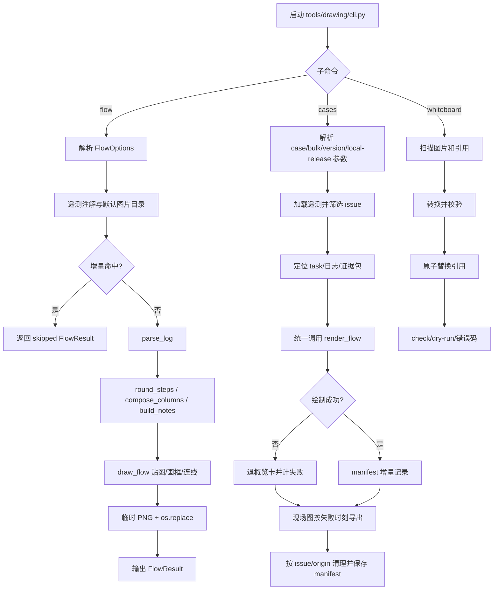

# tools/drawing 程序流程

## 总流程

## 入口与分发

`tools/drawing/cli.py` 只负责 `flow`、`cases`、`whiteboard` 的命令派发和延迟
导入。`flow_from_log.py` 与 `flow_cases.py` 是兼容入口包装；核心实现分别在
`lib/flowlog/` 与 `lib/cases/`。

## flow

1. 参数层：`flowlog/cli.py` 解析日志、时间窗、task/pid、vision/on_error、版面、
   遥测和输出参数；默认从日志同级目录取 `vision/` 与 `on_error/`。
2. 遥测层：`apply_telemetry()` 调用 `telemetry_index.annotate()`；只把可用的高
   置信匹配或显式 issue 写入命名、release 基线和图上注记；失败不阻止绘图。
3. 输入层：`render_flow()` 归一化日志和图片证据；输入、选项、代码摘要和旧图
   一致时直接返回 skipped。
4. 解析层：`parse_log()` 读取时间戳、Node.NextList、识别/动作、节点完成、任务结束、
   超时和失败；建立派发者、父节点、候选表、任务范围和失败事件。
5. 版面层：`round_steps()` 折叠连续步骤、分轮；`compose_columns()` 计算列和重复
   轮合并；`build_notes()` 生成诊断提示。
6. 绘制层：`draw_flow()` 建立 Vision/OnError 索引，贴缩略图，计算框、端口、连线、
   父节点分组、角标和图例；写临时 PNG 后 `os.replace()`。
7. 输出层：返回 `FlowResult`，输出步骤/框/轮次/尺寸和注记；`--list` 只输出解析结果。

## cases

1. 解析 `--case`、`--telemetry-bulk`、版本筛选、证据目录、本地 release 和清理开关。
2. 加载或刷新遥测库，按版本筛卡；批量场景从 evidence case 定位 task、终态派发者
   和可用日志。
3. 每个 job 可用本地 release 内容对账替换证据日志；调用统一 `render_flow()`，用
   manifest 分步摘要判定增量；失败继续计数，必要时退概览卡。
4. 现场图按这次日志里的失败事件取锚点，证据包优先，日志包兜底；复制到
   `<outdir>/images/`，sha 相同不重写。
5. 批量结束按 issue、`origin`、failed_issues 和本轮集合清理 PNG/Mermaid/现场图；
   单包 `origin=case` 在 issue 仍存在时不删除。
6. 保存 schema 2 manifest 和统计；只有失败且没有任何成功绘制时返回 1。

## whiteboard

扫描 root/dir 下图片和 canvas/markdown 引用；按目标格式转换并校验非空、可打开，
再原子替换引用。`--check` 只检查，`--dry-run` 不写文件；错误返回 1。

## 不可改变的契约

- `flow_from_log`、`flow_cases` 的公共 re-export、`FlowOptions`、`FlowResult`、
  `render_flow`、`parse_log` 及外部 selftest/import 名保持不变。
- FlowOptions 默认值、manifest schema 2、分步 trace 阶段和 `RENDERER_VERSION=29`
  不因拆分改变；新增模块必须同步 `cases/signature.py`。
- 日志解析不合成不存在的图片；遥测/git 不可用时仍尽可能绘图。
- `cases` 不复制渲染逻辑；所有流程图仍调用 `flowlog.render`。
- 产物使用临时文件 + `os.replace()`；清理保留失败 issue 的旧图、用户文件和单包产物。
