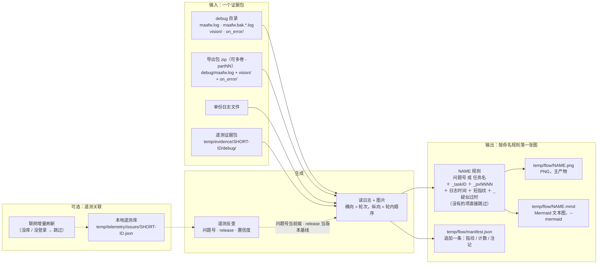
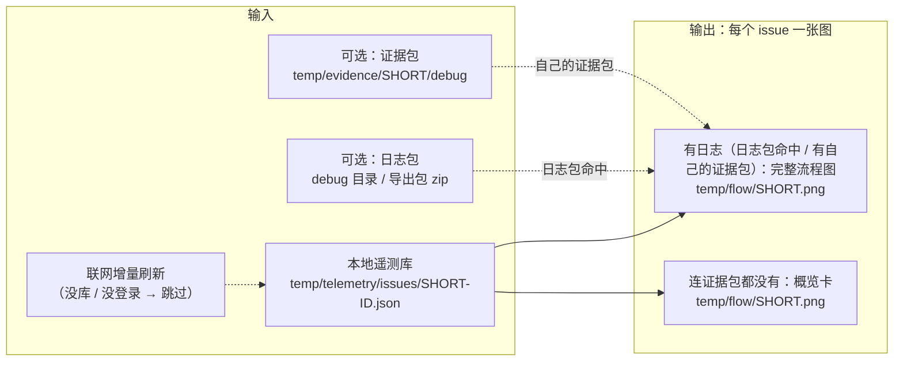

# 证据包与产物（`cases`）

一个证据包进、一张图出。虚线是**可选**的遥测关联（`--telemetry`，默认开）：只影响文件名前缀、
注记和「疑似过时」的版本基线，没有它照样出图。

## 输入输出工作流



`NAME` 的优先级（问题号 → 任务名 → 目录名）与附加项的出现条件，见下面「产物文件名」。

默认一个证据包出一张图；加 `--all-tasks` 时按任务各自反查遥测、各出一张（文件名 stem 换成各自的问题号），
产物仍是 `temp/flow/NAME.png` + `.mmd` + 同一条 `manifest.json` 账目。

**manifest 与幂等**：`temp/flow/manifest.json` 记每条产物的指纹（日志内容摘要 + 渲染参数 +
`RENDERER_VERSION`）与计数。同一份输入重跑会跳过（输出"跳过（已画过）"）；改了渲染口径而不 bump
`RENDERER_VERSION` 就会命中旧记录跳过——见 [pitfalls.md](./pitfalls.md)。`--force` 忽略 manifest 重画。

## 输入包的读取规则

- 一个 `debug` 目录、一组归档（`-partNN` 多卷要一起给）、或一份日志文件；
- 目录里只有轮转后的 `maafw.bak.*.log` 也认（取 mtime 最新）；
- 截图/现场图默认取 `<case>/vision`、`<case>/on_error`；传单份日志文件时取日志所在目录的那两个
  子目录，也可用 `--vision` / `--on-error` 指定别处（能指目录、归档包或它们的父目录）；
- `on_error/` 会递归扫子目录：遥测证据包把每次失败的现场图放在 `on_error/<run_id>/`，
  只画某一次就 `--on-error <case>/on_error/<run_id>`（不指定则按节点名+时间就近匹配）；
- 包里有图、但都不在本窗口（时刻对不上）时，顶部注记会点出文件名与时刻，不硬贴到本次失败上。

## 批量出图（遥测库驱动）

以**整个本地遥测库**（所有未解决 issue）为驱动，一次出一批图。每个 issue 尽量出**完整流程图**：
日志包命中的按任务出；没命中的用该 issue 自己的证据包日志出；连证据包都没有才退概览卡。



- **按版本筛**：加 `--telemetry-version ">=v1.0.0-beta.61"`（可重复，多条按「且」叠加）先把库里的 issue
  过一遍，只有命中的才进入后面的流程——没命中的不会被拉证据包，也不会出概览卡；`--case` 的包若**确定身份**
  且那个 issue 的版本不在范围内同样跳过（中/低置信的匹配不据此丢包）。写法与比较口径见 [telemetry.md](./telemetry.md)。
- **给了日志包**：先把日志里的失败在库里反查，**命中的 issue 按任务各出一张完整流程**
  （与 `--all-tasks` 同一个画法，文件名用问题号）。
- **没命中日志包的 issue**：用该 issue **自己的证据包**（`temp/evidence/<SHORT>/debug/` 里的
  `maafw.log` 尾部 + `on_error/`）画**完整流程图**——证据包就是那次运行的日志，不是"预览"。
  **本地没有就自动调 `evidence` 拉取**（默认开，需联网）；`--no-fetch-evidence` 关掉，
  `--telemetry-offline` 时也不拉。
- **筛选版本时先核对证据包的版本**：issue 跨多个版本，本地包可能是它早先那次运行的。包内版本
  （清单 `event.release` → 日志「资源版本：」行）不在筛选范围内就**按最新事件重拉**；重拉不了
  （离线 / `--no-fetch-evidence` / 包不在 `temp/evidence` 下）或重拉后仍不符 → 这个包不用来画流程，
  退概览卡并在终端说明（判据：`cases/evidence.py` 的 `_usable_evidence_case`）。
- **证据包从哪找**：默认 `temp/evidence/<问题号>/debug`。`--evidence-dir DIR` 可重复，按给的
  顺序往后找，最后才回到默认目录；每个根下依次认 `<DIR>/<问题号>/debug`、`<DIR>/<问题号>/`
  直接放日志、根目录名本身就是问题号，以及 `<DIR>` 下文件名带问题号的归档（多卷一起给，
  目录优先于归档）。
- **只画失败的那个 task**：证据包尾部常连着同一次运行的多个 task
  （Train → Escort → Battle → Training），整段画会把它们接成一条链。定位顺序是卡片或包清单里的
  `failure_task_id`（在日志的任务列表里时）→ 失败节点所在的 task → 任务入口名 → **包清单里的
  `failure_task_id` 即便不在任务列表里也用它**（Sentry 只留日志尾部，`node done` 被截掉的那个 task
  仍能靠失败事件的活动区间夹住，实测 PYTHON-2P 按 200000058 画出 45 步）；都定位不到、
  且日志里多于一个 task 时退概览卡，不混画。**包里的日志根本没有这个 task 的记录时也退概览卡**：
  这时整段日志属于别的运行（实测 `PYTHON-33/35/36` 的包只有 MFA 面板行，三张图会画成一模一样的
  混合日志），不再把整段识别记录当成它的步骤。
- **任务级失败按入口名认 task**：标题没有 `(节点/阶段)` 时（`Maa task failed: Replays`），
  用 `Task<label>` 去匹配步骤或 `Node.NextList` 派发者（`TaskReplays`）。一条 trace 里常挂着
  好几个 issue（`PYTHON-V` 与 Escort/Entrust/Training 共用一条），不认任务就会把整段日志画成
  同一个运行里**第一个**失败的那个；同一入口跑过多遍时还要跟清单的失败时刻对得上，挑不到就退概览卡。
- **终端是 `BaseTaskStopError` 时按上游派发者分桶**：文件名带 `BaseErrorNext` 的派发者与 task，
  例如 `PYTHON-2H_EscortEnterHome_task200000004.png`——同一个 issue 的不同运行/任务上游不同，
  各成一张、互不覆盖。历史上不同运行用 `evidence --issue <ID> --event <id>` 分别取（见 sentry README）。
- **连证据包都没有**才退化成**概览卡**（问题号 / 标题 / 失败节点 / 次数 / 最后出现 / 资源版本 / 链接，
  有 `on_error/` 时贴现场图），并在卡上写明用哪条命令补完整输出。
- **默认增量绘制**：manifest 里分步摘要一致的图直接跳过，画完只删掉不属于本次 issue 集合的旧产物；
  要整目录清空后全量重画用 `--clean-flow`，要"增量但不删"用 `--no-prune`。
  判据与清理规则见下面的[增量绘制与旧产物清理](#增量绘制与旧产物清理)。
- 产物：每个 issue 一张 `temp/flow/<SHORT>.png`（`--mermaid` 另出 `.mmd`），同样记进
  `manifest.json`（与单包出图同目录、同账目）。

## 增量绘制与旧产物清理

一个产物要不要重画，由 `manifest.json` 里那组**分步摘要**决定（`flowlog/trace.py`）。
每一步各算一个 sha256 短摘要，整条轨迹再合成一个 `trace`：

| 阶段 | 谁算 | 内容 |
| --- | --- | --- |
| `parse_impl` | `cases/signature.py` | 读日志/解释数据那批模块的代码摘要（`logparse`、`model`、`notes`、`stale`、`constants`、`paths`、`tools/_pipeline_state.py`） |
| `raster_impl` | 同上 | 画像素那批模块的代码摘要（`layout`、`paint`、`draw`、`media`、`render`） |
| `input` | `cases/runner.py` | 选中的日志摘要、`case.describe()`、有没有 vision/on_error |
| `repo` | `cases/signature.py` | 仓库 `HEAD`：只当"要不要重新核对「疑似过时」"的开关，**不算数据步** |
| `options` | `flowlog/render.py` | `FlowOptions` 的非派生字段（窗口、`task_id`、`px`、版本、问题号、额外注记…） |
| `parse` | 同上 | `ParsedLog` 全量规范化（步骤名/顺序/候选/`task_id_`/`derived_from`/区间/回跳/截断计数/NextList 统计） |
| `notes` | 同上 | 最终注记列表（`(文本, 颜色)`，含遥测注记与失败现场图注记） |
| `stale` | 同上 | 「疑似过时」检查结果（节点、模块、提交） |
| `card` | `render_overview` | 概览卡的标题/字段/注记/现场图清单 |

**判定顺序**（终端会打 `跳过（…）` 或 `重画（…）`，括号里是第一个不同的是哪一步）：

1. `raster_impl` 变了 → 必须重画（数据一字不差，像素也可能不同）。
2. `parse_impl`、`input`、`options`、`repo` 都没变 → **不读日志**直接跳过
   （`parse_log()` 只读日志正文/窗口/task/px，这几样没变，解析结果必然相同）。
3. 否则读一遍日志，比 `input`/`options`/`parse`/`notes`/`stale`：全同 → 跳过（只是"读了但没用上"）；
   不同 → 重画，理由写清是哪一步变了。`repo` 只在这里当"要不要重新核对「疑似过时」"的开关：
   只提交了代码时走这一条，`stale` 没变就跳过。

**为什么像素那段要按代码摘要判**：改 `draw.py` 的框线颜色、`paint.py` 的字号，这次运行的每一步
数据都不变，图却不一样。数据步没法表达这件事，只能承认"这五个文件改了就得重画"。

**代码摘要按规范化 AST 算**（`cases/signature.py:module_digest`）：去掉 docstring、不带行号，
所以改注释、改文档字符串不会重画；改任何代码结构或字面量都会。

**清理旧产物**（`cases/output.py:prune_artifacts`，批量模式画完后执行）。每条 manifest 记录带
`issue`（问题号）与 `origin`（`bulk` / `case`），据此判断：

| 情况 | 动作 |
| --- | --- |
| 名字带路径分隔符（坏 manifest 防御） | 不动 |
| 记录没有 `issue`，文件名前缀也不是问题号 | 不动（单包按任务名命名的、用户自己放的文件） |
| 归属 issue 这次什么都没画出来（渲染失败、缺 Pillow） | 不动（保住上一轮能看的图） |
| 归属 issue 不在本次 issue 集合（版本筛掉 / 已 resolve / 库里消失） | 删 `png` + 同干 `.mmd` + 删记录 |
| 归属 issue 在集合里，但这条是批量画的（`origin == "bulk"`，或名字是 `<SHORT>.png` / `<SHORT>_疑似过时.png`）且本次没保留 | 删（被本次重画取代） |
| 其余（单包画的、issue 仍在集合里） | 不动 |
| 记录指向的文件已经不在 | 丢掉记录（否则同名会一直被当成"被占用"） |

只动 manifest 里有记录的产物：`explore-csv` 的 `<csv 名>.log`、子目录、用户自己放的 png 一律不碰。
删掉几个会在终端逐条打 `删掉旧产物（<理由>）：<文件名>`，收尾统计里也有一项 `清理 N 个旧产物`。

`manifest.json` 里跟增量有关的字段（`schema` 现在是 2）：

| 位置 | 内容 |
| --- | --- |
| `cases.<文件名>.trace` | 整条轨迹的合成 sha |
| `cases.<文件名>.trace_stages` | 各阶段的分步 sha（上表那九个阶段，概览卡只有 `raster_impl` 与 `card`） |
| `cases.<文件名>.issue` / `.origin` | 归属问题号、`bulk` 还是 `case` 画的（清理用） |
| `signature` | 本次运行的两段代码摘要（下次启动会打「上次 … 变了」） |
| `bulk` | 本次批量的时间、`--telemetry-version` 条件、issue 名单、清掉了几个 |

终端开头的 `代码摘要：读取实现 …，绘制实现 …（上次 …）` 就是 `signature` 的对比结果：绘制实现变了
说明这批图要整批重画；只有读取实现变了则是"下一轮会多读一遍日志、数据没变照样跳过"。

**不做 / 边界**：

- 库里一个 issue 都没有、或版本筛完为空时**不清理**（那通常意味着刷新失败或条件写错，不能按空集合删目录）。
- 单包产物在批量里也会被删：issue 已不在本次集合时，它的单包图同样过期。
  不想让批量动它就换 `--outdir` 或加 `--no-prune`。
- 图片内容不参与判据：`vision/`、`on_error/` 只记"有没有"，换了图不改名不改数量不会触发重画（要重画用 `--force`）。
- `repo` 只记 `HEAD`：提交后会把日志再读一遍核对「疑似过时」，标记没变就跳过（不会因为一次无关提交整批重画）；
  工作区里改了资源定义但没提交不触发。
- `RENDERER_VERSION` 仍按约定在口径变化时 +1，但增量正确性不再依赖它（摘要会自己发现代码变了）。

## 本地 release 辅助（默认开）

Sentry 证据包是别人那次运行的**截断切片**（`vision/` 被 MFA 跳过、日志只留尾部）；如果那次运行
就发生在本机，本地 release（默认 `D:/MaaAshArms`）里留着**同一份运行**的完整日志和画面帧，画出来
的信息量大得多。默认就去找，认不出就不用。

**只按内容认，不按时间**：同一个时刻可能有好几个用户都在跑同一个任务，按时间挑就会把别人的运行
当成这次；本地轮转日志的文件名又是"轮转时刻"、不是内容区间。所以认身份只用下面三条：

1. **本机事件号**：失败事件会被本机面板日志（`logs/log-*.log`）记一行
   `[Telemetry] 失败事件已加入发送队列：event_id=<32 位>`，只有产生它那台机器会打。
   证据包的 `event_id` 在里面 → 这次运行确实发生在本机（图注里会写"面板日志 log-2026… 记着这个事件"）；
   不在也不排除（面板日志会被轮转清掉），继续看下面两条。
2. **日志行对账**：从证据包日志里取几行独特行——`PipelineTask node done`、`Task timeout`、
   `invalid node id`、`node not completed`、`reco [result=`，在本地各份 `debug/maafw*.log` 里找
   **逐字出现**的那一份；有失败行的包还要求那一行也在（一次运行跨日志轮转时，只有前半段的日志不算）。
   **事件总线那两种行不算**（`!!!OnEventNotify!!!` / `ctx_event_sink`）：同一次识别会被两个进程各写
   一份、格式不同，逐字比对必然对不上。
3. **`task_id` 复核**：给了 `task_id` 时，那份日志里必须真有这个 task（`task_id_=<id>` /
   `"task_id":<id>` / `task_id=<id>`，后面不能再接数字）。**它比失败行锚定更硬**：一条 trace 上常挂着
   好几个 issue（实测 `PYTHON-1E` 与训练/委托那几个共用一条），包的日志切片里失败行可能属于**另一个**
   任务；这时按失败行挑会挑到别的运行那一份，而真正跑过这个 task 的是轮转掉的另一份日志
   （实测 `maafw.bak.2026.11.09-17.51.32.668.log` 里有 task 200000004，从 17:33:44 跑到 17:37:19）。
   给了 task 时失败行只在候选之间优先，选中后若不是它，终端会打一行"按 task 定位到 …"。

对上**唯一**一份才用；对上多份或零份就不参与，日志里写清原因。时间只在"没有事件号"时用来
**缩小候选范围**（先看哪些日志的内容区间盖住这个包），从不单独决定是哪一次。

认出来之后：用本地那份完整日志渲染，图片取本地同目录的 `vision/`、`on_error/`；图上加两行注记
（注记逐行截断，所以拆成两条）：`本地 release 辅助：maafw.bak.<时间>.log` 与
`<N> 行逐字相同、task <id>[、本机事件]`。
本地也画不出（那个 task 的记录不在这份里）就自动退回证据包，两条都失败才退概览卡。

| 开关 | 作用 |
| --- | --- |
| 默认 | 读 `D:/MaaAshArms`；目录不在就只用证据包，不报错 |
| `--local-release DIR` | 换一个安装目录 |
| `--no-local-release` | 完全不用本地文件 |
| 环境变量 `MAA_DRAWING_LOCAL_ROOT` | 等价于 `--local-release`，但只在没给参数时生效 |

**产物名不变**（同一个 issue 只该有一张图）。用了本地日志后输入变了，`manifest` 的指纹不同：
同名文件会被判成"另一份输入"，于是追加日志时间/短路哈希另存一张——旧的证据包版本不会被覆盖。
`--case <多份日志的目录>` 时，给了 `--task-id` 会按"哪份日志里有这个 task"挑（不止一份对上时
回到默认：确切名优先，否则 mtime 最新），并打出选了哪份。

## 产物文件名

`<问题名或任务名>[_task<id>][_px<进程>][_<日志时间>][_<短指纹>][_疑似过时].png`，优先级：

1. **遥测问题名**：证据包目录名就是 issue 的 `short_id`（`temp/evidence/PYTHON-1Z/` → `PYTHON-1Z`）；
   `--case` 指到 `debug/` 那层时往上找一层，归档来源看文件名（`PYTHON-1Z-part01.zip` → `PYTHON-1Z`）。
   认不出的目录名（`20261019`、`debug`）不算问题名。

   **问题一旦关联上遥测，就按遥测的命名规则走**：`--telemetry` 反查命中、或 `--telemetry-issue`
   指定后，前缀直接是 issue 的 `short_id`，与 `temp/evidence/<SHORT-ID>/` 同一套，不再回落到
   目录名/任务名。`--all-tasks` 时**每个任务各自反查**（只认该 task 自己的 `task_id`），
   所以同一次运行里的两张图可能带不同的问题号——那是真事，不是名字串了。
2. **任务名**：日志里 `Tasker.Task.*` 事件的 `entry`（`TaskTrain` 这种）。给了 `--task-id` 时只认那个
   task 的 `PipelineTask node done [...] [task_id_=N]` 行，取其中的入口型节点名（`Task*` 开头）。
3. **证据包目录名**：前两者都没有时的兜底。

同名处理（任一条命中就追加日志时间 `_20261024155229`，即 `--from`/`--to` 或日志第一行的时间戳）：

- 磁盘上已有同名文件、且不是本工具画的（manifest 里没登记）；
- manifest 里同名条目登记的是**另一份**日志（日志指纹不同）。

时间标签也冲突时再追加日志短指纹（`_6d990a8f6cdf66b6`），保证结果确定、不覆盖别人的产物。
同一份日志 + 同一套参数仍落在原名上，manifest 幂等不变。

**文件名不再带 `flow_` 前缀**（v10）：产物本来就在 `temp/flow/` 下，前缀只是重复。旧产物
（`temp/flow/flow_*.png`）不会被自动改名或删除，需要的话自己清一遍。

**「疑似过时」命中时，`_疑似过时` 追加在文件名最末尾**（扩展名之前）：`X.png` → `X_疑似过时.png`，
带时间标签时是 `X_20261024-031849_疑似过时.png`。后缀用中文，文件名本身就写清这是哪一类产物。
这个后缀**只能等画完才知道**（检查要拿到日志里实际跑过的节点名），所以是渲染后 `os.replace` 改名，
`.mmd` 跟着一起改；幂等检查同时认 `X.png` 与 `X_疑似过时.png` 两种名字。

**`--all-tasks`：按任务逐个输出，一个 `(进程, task_id)` 一张图。** 不加这个参数时整份日志混画一张
（跨多次运行的任务会叠在一起）；加了之后先 `scan_tasks()` 扫出所有任务，再逐任务渲染，
文件名带 `_task<id>_px<进程>`：

```powershell
python tools/drawing/cli.py cases --case D:/MaaAshArms/debug --all-tasks
# temp/flow/TaskTrain_task200000030_px30992.png          ← 遥测没匹配上时用任务名
# temp/flow/PYTHON-1Z_task200000001_px15316.png           ← 匹配上就用问题号（遥测命名规则）
# temp/flow/PYTHON-2H_task200000001_px6448.png            ← 同号不同进程，各画各的
```

`task_id` 在每个进程里从同一个基数重新分配，所以文件名的进程号是**唯一性的一部分**，不是装饰。

**带 `--task-id` 时文件名只写 `_task<id>`、不写任务名**：一个 issue 里常有多个任务失败（实测
`PYTHON-1Z` 有 6 个），而那个 task 的入口行不一定在导出的那一段里（实测 200000007 只留下
`BaseReturnHome`，它不是任务入口）——`task<id>` 唯一且一定对，宁可少一个名字，不放一个可能错的名字。
