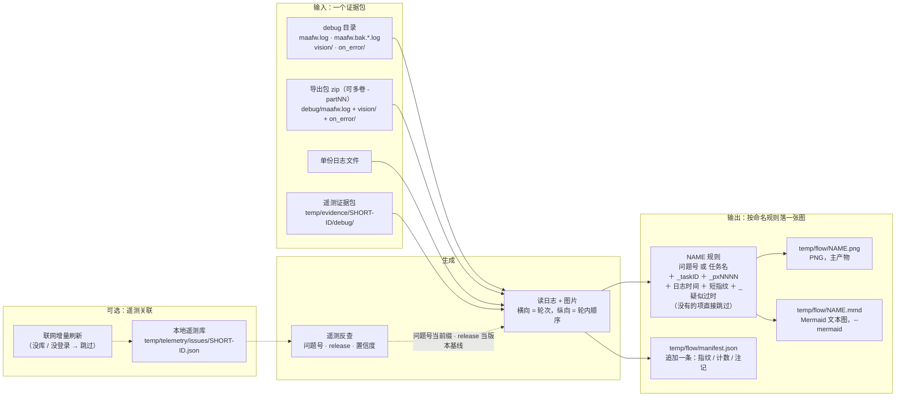
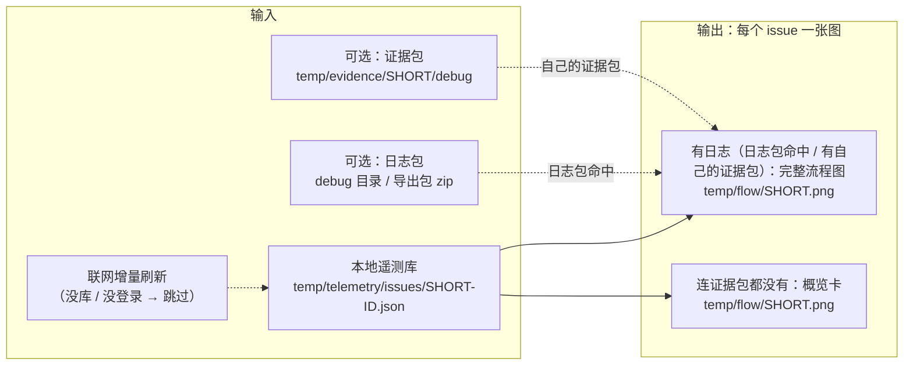

# 证据包与产物（`cases`）

一个证据包进、一张图出。虚线是**可选**的遥测关联（`--telemetry`，默认开）：只影响文件名前缀、
注记和「疑似过时」的版本基线，没有它照样出图。

## 输入输出工作流



`NAME` 的优先级（问题号 → 任务名 → 目录名）与附加项的出现条件，见下面「产物文件名」。

默认一个证据包出一张图；加 `--all-tasks` 时按任务各自反查遥测、各出一张（文件名 stem 换成各自的问题号），
产物仍是 `temp/flow/NAME.png` + `.mmd` + 同一条 `manifest.json` 账目。

**manifest 与幂等**：`temp/flow/manifest.json` 记每条产物的指纹（日志内容摘要 + 渲染参数 +
`RENDERER_VERSION`）与计数。同一份输入重跑会跳过（输出"跳过（已画过）"）；改了渲染口径而不 bump
`RENDERER_VERSION` 就会命中旧记录跳过——见 [pitfalls.md](./pitfalls.md)。`--force` 忽略 manifest 重画。

## 输入包的读取规则

- 一个 `debug` 目录、一组归档（`-partNN` 多卷要一起给）、或一份日志文件；
- 目录里只有轮转后的 `maafw.bak.*.log` 也认（取 mtime 最新）；
- 截图/现场图默认取 `<case>/vision`、`<case>/on_error`；传单份日志文件时取日志所在目录的那两个
  子目录，也可用 `--vision` / `--on-error` 指定别处（能指目录、归档包或它们的父目录）；
- `on_error/` 会递归扫子目录：遥测证据包把每次失败的现场图放在 `on_error/<run_id>/`，
  只画某一次就 `--on-error <case>/on_error/<run_id>`（不指定则按节点名+时间就近匹配）；
- 包里有图、但都不在本窗口（时刻对不上）时，顶部注记会点出文件名与时刻，不硬贴到本次失败上。

## 批量出图（遥测库驱动）

以**整个本地遥测库**（所有未解决 issue）为驱动，一次出一批图。每个 issue 尽量出**完整流程图**：
日志包命中的按任务出；没命中的用该 issue 自己的证据包日志出；连证据包都没有才退概览卡。



- **按版本筛**：加 `--telemetry-version ">=v1.0.0-beta.61"`（可重复，多条按「且」叠加）先把库里的 issue
  过一遍，只有命中的才进入后面的流程——没命中的不会被拉证据包，也不会出概览卡；`--case` 的包若**确定身份**
  且那个 issue 的版本不在范围内同样跳过（中/低置信的匹配不据此丢包）。写法与比较口径见 [telemetry.md](./telemetry.md)。
- **给了日志包**：先把日志里的失败在库里反查，**命中的 issue 按任务各出一张完整流程**
  （与 `--all-tasks` 同一个画法，文件名用问题号）。
- **没命中日志包的 issue**：用该 issue **自己的证据包**（`temp/evidence/<SHORT>/debug/` 里的
  `maafw.log` 尾部 + `on_error/`）画**完整流程图**——证据包就是那次运行的日志，不是"预览"。
  **本地没有就自动调 `evidence` 拉取**（默认开，需联网）；`--no-fetch-evidence` 关掉，
  `--telemetry-offline` 时也不拉。
- **筛选版本时先核对证据包的版本**：issue 跨多个版本，本地包可能是它早先那次运行的。包内版本
  （清单 `event.release` → 日志「资源版本：」行）不在筛选范围内就**按最新事件重拉**；重拉不了
  （离线 / `--no-fetch-evidence` / 包不在 `temp/evidence` 下）或重拉后仍不符 → 这个包不用来画流程，
  退概览卡并在终端说明（判据：`cases/evidence.py` 的 `_usable_evidence_case`）。
- **证据包从哪找**：默认 `temp/evidence/<问题号>/debug`。`--evidence-dir DIR` 可重复，按给的
  顺序往后找，最后才回到默认目录；每个根下依次认 `<DIR>/<问题号>/debug`、`<DIR>/<问题号>/`
  直接放日志、根目录名本身就是问题号，以及 `<DIR>` 下文件名带问题号的归档（多卷一起给，
  目录优先于归档）。
- **只画失败的那个 task**：证据包尾部常连着同一次运行的多个 task
  （Train → Escort → Battle → Training），整段画会把它们接成一条链。定位顺序是卡片或包清单里的
  `failure_task_id`（在日志的任务列表里时）→ 失败节点所在的 task → 任务入口名 → **包清单里的
  `failure_task_id` 即便不在任务列表里也用它**（Sentry 只留日志尾部，`node done` 被截掉的那个 task
  仍能靠失败事件的活动区间夹住，实测 PYTHON-2P 按 200000058 画出 45 步）；都定位不到、
  且日志里多于一个 task 时退概览卡，不混画。
- **终端是 `BaseTaskStopError` 时按上游派发者分桶**：文件名带 `BaseErrorNext` 的派发者与 task，
  例如 `PYTHON-2H_EscortEnterHome_task200000004.png`——同一个 issue 的不同运行/任务上游不同，
  各成一张、互不覆盖。历史上不同运行用 `evidence --issue <ID> --event <id>` 分别取（见 sentry README）。
- **连证据包都没有**才退化成**概览卡**（问题号 / 标题 / 失败节点 / 次数 / 最后出现 / 资源版本 / 链接，
  有 `on_error/` 时贴现场图），并在卡上写明用哪条命令补完整输出。
- 产物：每个 issue 一张 `temp/flow/<SHORT>.png`（`--mermaid` 另出 `.mmd`），同样记进
  `manifest.json`（与单包出图同目录、同账目）。

## 产物文件名

`<问题名或任务名>[_task<id>][_px<进程>][_<日志时间>][_<短指纹>][_疑似过时].png`，优先级：

1. **遥测问题名**：证据包目录名就是 issue 的 `short_id`（`temp/evidence/PYTHON-1Z/` → `PYTHON-1Z`）；
   `--case` 指到 `debug/` 那层时往上找一层，归档来源看文件名（`PYTHON-1Z-part01.zip` → `PYTHON-1Z`）。
   认不出的目录名（`20261019`、`debug`）不算问题名。

   **问题一旦关联上遥测，就按遥测的命名规则走**：`--telemetry` 反查命中、或 `--telemetry-issue`
   指定后，前缀直接是 issue 的 `short_id`，与 `temp/evidence/<SHORT-ID>/` 同一套，不再回落到
   目录名/任务名。`--all-tasks` 时**每个任务各自反查**（只认该 task 自己的 `task_id`），
   所以同一次运行里的两张图可能带不同的问题号——那是真事，不是名字串了。
2. **任务名**：日志里 `Tasker.Task.*` 事件的 `entry`（`TaskTrain` 这种）。给了 `--task-id` 时只认那个
   task 的 `PipelineTask node done [...] [task_id_=N]` 行，取其中的入口型节点名（`Task*` 开头）。
3. **证据包目录名**：前两者都没有时的兜底。

同名处理（任一条命中就追加日志时间 `_20261024155229`，即 `--from`/`--to` 或日志第一行的时间戳）：

- 磁盘上已有同名文件、且不是本工具画的（manifest 里没登记）；
- manifest 里同名条目登记的是**另一份**日志（日志指纹不同）。

时间标签也冲突时再追加日志短指纹（`_6d990a8f6cdf66b6`），保证结果确定、不覆盖别人的产物。
同一份日志 + 同一套参数仍落在原名上，manifest 幂等不变。

**文件名不再带 `flow_` 前缀**（v10）：产物本来就在 `temp/flow/` 下，前缀只是重复。旧产物
（`temp/flow/flow_*.png`）不会被自动改名或删除，需要的话自己清一遍。

**「疑似过时」命中时，`_疑似过时` 追加在文件名最末尾**（扩展名之前）：`X.png` → `X_疑似过时.png`，
带时间标签时是 `X_20261024-031849_疑似过时.png`。后缀用中文，文件名本身就写清这是哪一类产物。
这个后缀**只能等画完才知道**（检查要拿到日志里实际跑过的节点名），所以是渲染后 `os.replace` 改名，
`.mmd` 跟着一起改；幂等检查同时认 `X.png` 与 `X_疑似过时.png` 两种名字。

**`--all-tasks`：按任务逐个输出，一个 `(进程, task_id)` 一张图。** 不加这个参数时整份日志混画一张
（跨多次运行的任务会叠在一起）；加了之后先 `scan_tasks()` 扫出所有任务，再逐任务渲染，
文件名带 `_task<id>_px<进程>`：

```powershell
python tools/drawing/cli.py cases --case D:/MaaAshArms/debug --all-tasks
# temp/flow/TaskTrain_task200000030_px30992.png          ← 遥测没匹配上时用任务名
# temp/flow/PYTHON-1Z_task200000001_px15316.png           ← 匹配上就用问题号（遥测命名规则）
# temp/flow/PYTHON-2H_task200000001_px6448.png            ← 同号不同进程，各画各的
```

`task_id` 在每个进程里从同一个基数重新分配，所以文件名的进程号是**唯一性的一部分**，不是装饰。

**带 `--task-id` 时文件名只写 `_task<id>`、不写任务名**：一个 issue 里常有多个任务失败（实测
`PYTHON-1Z` 有 6 个），而那个 task 的入口行不一定在导出的那一段里（实测 200000007 只留下
`BaseReturnHome`，它不是任务入口）——`task<id>` 唯一且一定对，宁可少一个名字，不放一个可能错的名字。
