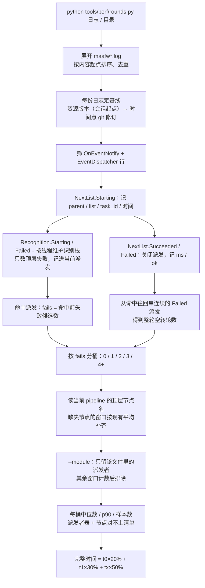
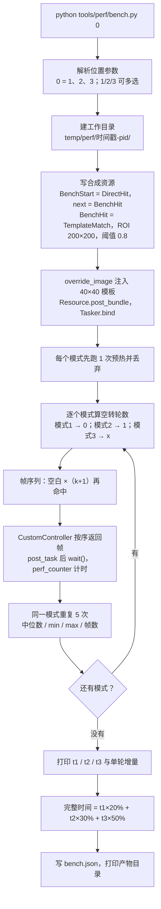
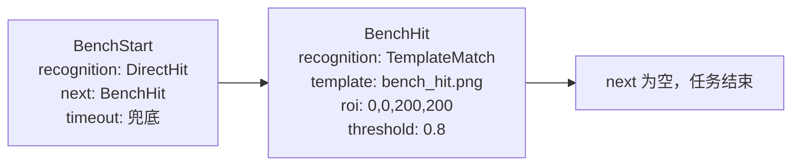

# tools/perf —— 性能基准（合成下限 + 真实日志）

两个入口，回答的问题不同：

| 入口 | 数据源 | 回答什么 | 判断真实优化收益 |
| --- | --- | --- | --- |
| [`rounds.py`](rounds.py) | 真实 `maafw.log` 的 `Node.NextList.*` / `Node.Recognition.*` | 一次派发要多久、命中前有几个失败候选、加权完整时间 | **用这个** |
| [`bench.py`](bench.py) | 合成 pipeline + 内存帧 | MaaFW 的框架下限（不含真实识别、真机截图、`rate_limit`） | 只在换 MaaFW 版本/换机器时比 |

> 判断「改 pipeline 有没有变快」「真机上一轮多久」用 `rounds.py`；`bench.py` 的数字不能当成真机一轮的时间。

## 为什么合成基准不能直接当参考

同一台机器、同一天：

| 口径 | 0 个失败候选 | 1 个 | 2 个 | 加权 |
| --- | --- | --- | --- | --- |
| `bench.py`（合成） | 27 ms | 42 ms | 65 ms | 50 ms |
| `rounds.py`（今日 `debug/maafw.log`） | 116 ms | 768 ms | 4262 ms | 2385 ms |

三个原因：

- **`rate_limit` 被置 0**：默认 1000 ms/轮，真实等待的大头；`bench.py` 默认不等待。
- **识别是 40×40 模板**：真实 pipeline 里是 OCR / 自定义识别，失败候选 0.1–4 s，模板匹配只占几十毫秒。
- **截图是内存拷贝**：`CustomController` 直接返回 numpy 帧，真机 ADB 截图还要 50–300 ms。

另外，真实日志里「整轮空转后还能命中」的窗口几乎没有：今日日志 0 个，17 MB 备份里 3 个（最多 1 轮）。
`NextList.Failed` 大多以任务结束 / 超时收尾。真正占大头的是**一次派发里失败候选**，所以 `rounds.py`
按「命中前失败候选数」分桶；`bench.py` 仍保留原来的「整轮空转」口径，用于框架层比较。

## 真实日志：rounds.py

```bash
python tools/perf/rounds.py debug/maafw.log
python tools/perf/rounds.py debug/                          # 目录里所有 maafw*.log（含 .bak）
python tools/perf/rounds.py temp/evidence/PYTHON-2H/debug/maafw.log --x 2
python tools/perf/rounds.py debug/ --top 0                   # 派发者表列出全部
python tools/perf/rounds.py debug/ --module escort           # 只看 escort.json 这个模块
python tools/perf/rounds.py debug/maafw.log --mfa-log D:/MaaAshArms/logs   # 单独拷出来的日志
python tools/perf/rounds.py debug/maafw.log --no-pipeline    # 不读 pipeline，不核对也不补平均
python tools/perf/rounds.py debug/ --json temp/perf/rounds.json
python tools/perf/rounds.py --selftest
```

一次实测（`debug/maafw.log`）：

```
文件：debug\maafw.log  派发 54（命中 52，未命中轮 2，剔除 >10000 ms 0）
      时间 2026-11-02 15:03 → 2026-11-05 15:39
      基线 时间点 f7959833（附近没有「资源版本」标记，按会话起点的 git 修订）
      改过 1 个派发者：EntrustBranchChapter（只标注，时长仍计入）

按「命中前失败候选数」分桶（窗口 52 个）：
   0 个：n=  26  中位      116 ms  p90     2832 ms
   1 个：n=  18  中位      768 ms  p90     4627 ms
   2 个：n=   6  中位     4262 ms  p90     5980 ms
  4+ 个：n=   2  中位     5309 ms  p90     5848 ms

完整时间 = t0×20% + t1×30% + t2×50% = 2385 ms（n=26/18/6）
整轮空转：命中前空转的窗口 0 个；整轮未命中 2 次（多数以任务结束/超时收尾）

派发者（按窗口总耗时排序）：
  TaskEntrust | 当前 是 | n=16 | 中位 158 ms | p90 4551 ms | 0/1/2+ = 12/0/4
  EntrustBranchChapter | 当前 是 | n=5 | 中位 5029 ms | p90 5980 ms | 0/1/2+ = 0/3/2
  ……
当前 pipeline 共 309 个节点，本次日志派发了 14 个；其余 295 个没跑到或新增（……；不参与统计）。
```

| 参数 | 默认 | 含义 |
| --- | --- | --- |
| `logs`（位置，可多个） | `debug/` | 日志文件、目录或通配；目录只收 `maafw*.log`（含 `.bak`），不给则扫 `debug/` |
| `--mfa-log` | — | MFA 界面日志目录（`logs/log-*.log`）；单独拷出来的 `maafw.log` 用这个指过去 |
| `--x` | `2` | 第三桶的失败候选数；`4+` 是合并桶 |
| `--max-ms` | `10000` | 超过这个耗时的窗口当挂起剔除 |
| `--min-samples` | `3` | 三个桶各自的最低样本数，不够不算完整时间 |
| `--module` | — | 只看某个模块：`pipeline/` 下的文件名去 `.json`（`escort` / `escort.json` 都行），可重复 |
| `--pipeline-dir` | `assets/resource/pipeline` | 当前 pipeline 目录，读顶层节点名用于核对与补平均 |
| `--no-pipeline` | — | 不读当前 pipeline，跳过核对与平均值补齐 |
| `--top` | `10` | 派发者表最多显示几个（`0` = 全部） |
| `--json` | — | 把结果写到这个路径 |
| `--log-level` / `--log-file` | `INFO` / 自动 | 工具日志（stderr + `temp/logs/`） |
| `--selftest` | — | 纯逻辑自检 |

`--json` 里的字段：`buckets`、`weighted_ms`、`modules`、`dropped_windows`、`stale_nodes`、`nodes[]`
（`in_pipeline` / `imputed` / `stale` / `median_ms` / `raw_median_ms` / `p90_ms` / `fails_0` /
`fails_1` / `fails_2plus`）、`missing_in_pipeline`、`unseen_in_pipeline`、`imputed_avg_ms`、
`imputed_windows`；`files[]` 里每份日志另有 `span`（起止时间）与 `baseline`（`version` /
`source` / `updates` / `rev` / `stale` / `changed_modules` / `reason`）。

### 多份日志与「改过」标注

`maafw.log` 每次启动会被换名成 `maafw.bak.<换名时刻>.log`，文件名里的时刻是**下一次启动**
那一刻，不是日志内容的时间：本机 `maafw.bak.2026.11.05-00.03.35.605.log` 收的是 11-04 00:50 →
11-05 00:03 那段。所以传目录时按**内容起点**排序，重复的（同一份日志被拷过两份）按「内容起点
+ 文件大小」丢掉，日志行里给出真实时间跨度。

每份日志算一条基线，用来判断「统计出来的耗时还能不能代表现在的节点」：

1. 取会话**起点**生效的资源版本 `资源版本：vX.Y.Z`：优先日志自己那行；没有就找同装 MFA 界面
   日志（`<日志目录>/logs/log-*.log`、`<日志目录>/../logs/log-*.log`，`--mfa-log` 再补一个目录）。
   会话内版本变过就写「会话内变过 N 次」——本机 β52→β55、β63→β64 都发生在会话中间，
   一份日志一个版本不成立。
2. 版本取不到（日志被单独拷出来、或早于仓库历史）才退到「会话起点时 git 里 pipeline 的修订」，
   输出写「时间点」+ 短哈希。
3. 拿基线那一刻的节点定义和当前工作区逐节点比：不同就标「改」。只比定义，不比 diff 里的名字
   （文件重排不会把整份文件标上）；**只标注，不改数字**，派发者表里名字后面带「改」，末尾给
   一行「N 个派发者在日志之后改过」。

```
文件：D:\MaaAshArms\debug\maafw.log  派发 172（命中 163，未命中轮 1，剔除 >10000 ms 7）
      时间 2026-11-05 00:03 → 2026-11-05 00:37
      基线 v1.0.0-beta.65，MFA日志｜会话内变过 1 次
      改过 1 个派发者：TaskMaintenance（只标注，时长仍计入）
```

按本机安装目录（`D:\MaaAshArms\debug`，4 份、10-25 → 11-05）实测：1685 个窗口，
0/1/2 个失败候选的中位 **580 / 1397 / 2588 ms**，完整时间 **1829 ms**；四份日志的基线分别是
β52 / β55 / β64 / β65。仓库里 `debug/` 那两份合并是 383 个窗口、完整时间 1618 ms——t1/t2 的
中位都落在 1981 ms，因为 4 个已删节点的 50 个窗口按现有节点平均补齐后正好集中在这个值附近。

### 只看一个模块（`--module`）

`--module escort` 与 `--module escort.json` 等价：按 `pipeline/escort.json` 里的顶层节点名收窄窗口，
分桶、完整时间、派发者表都只算这个模块；多个模块用多次 `--module`。

- 归属只看**当前**文件里的节点名：别的模块的窗口被排除，个数会打印出来。
- 已从 pipeline 删除的节点归不到模块（日志里没有文件名），模块视图里同样排除——要看删除节点的
  平均补齐，就不带 `--module`。
- `--no-pipeline` 与 `--module` 互斥（没有节点表就定位不了模块）；模块名写错直接报错，不静默返回空表。

实测（17 MB 备份，`--module escort`）：49 个窗口，t0 / t1 / t2 = 134 / 678 / 763 ms，完整时间 612 ms，
另有 282 个窗口属于别的模块；不带 `--module` 的整份日志是 331 个窗口、完整时间 1567 ms。

解析口径：

- 一次派发 = `Node.NextList.Starting` → `Succeeded` / `Failed`；耗时取两端时间差。
- 失败候选 = 该次命中里**顶层**的 `Node.Recognition.Failed`；`Or` / `And` 内部的嵌套失败不计。
- 整轮空转 = 连续的未命中 `NextList.Failed` 派发；往回串的间隔上限 10 s。
- `NextList.Failed` 也包含 `need_to_stop`（任务停止）那一种，所以「未命中轮」不等于「超时」。
- 同一事件在日志里有 `[msg=...]`（事件总线）与 `[message=...]`（agent sink）两行；只读前者，避免翻倍。
- 截断的行（证据包按块切过）跳过并计数；`--max-ms` 之外的挂起不计入中位数。



### 节点对不上时（新增 / 删除 / 改名）

日志是**当时**的 pipeline 跑出来的，现在的 `assets/resource/pipeline/` 可能已经改过。`rounds.py`
默认读当前 pipeline 的顶层节点名，只做**标记**，不改统计：

- **日志里有、当前 pipeline 没有**：按日志名保留在派发者表里，`当前` 列写 `否`；窗口**不排除**，
  但时长换成**现有节点窗口的平均值**（被替换的旧时长不参与这个平均），表里显示 `中位 X（原 Y）`。
  改名与删除在这里都显示为「没有」——日志里没有新旧名的对应关系，不猜。
- **当前 pipeline 有、日志里没派发**：不算错误，只统计个数；「新增」与「本次没跑到」在日志里分不开。
- **框架伪节点**（如 `@mse/action`）：`当前` 列写 `框架`，不算删除，也不参与「缺失节点」的补齐。

实测（17 MB 备份日志）：4 个派发者当前 pipeline 没有（`EscortBranchAccept`、`EscortClickDelivery`、
`EscortClickOk`、`ReturnMain`），共 50 个窗口，按现有节点的平均 2066 ms 计入；完整时间 1567 ms
（如果直接沿用旧时长是 1361 ms，两者差的就是补齐的影响）。`EscortBranchAccept` 的窗口最多（37 个），
仍按日志名排在表头，`中位 2066 ms（原 1890）`。

## 合成下限：bench.py

三种模式用同一条两节点任务，只改喂进去的帧序列：

| 模式 | 空转轮数 k | screencap 顺序 | 预期帧数 |
| --- | --- | --- | --- |
| 1 必定命中且瞬间触发 | 0 | 空白 → 命中 | 2 |
| 2 next 空转 1 轮 | 1 | 空白 → 空白 → 命中 | 3 |
| 3 next 空转 x 轮 | x | 空白 ×(x+1) → 命中 | x+2 |

```bash
python tools/perf/bench.py 0                    # 三种都跑，出完整时间
python tools/perf/bench.py 1                    # 只测「瞬间命中」
python tools/perf/bench.py 2 3 --x 4            # 只测空转；模式 3 空转 4 轮
python tools/perf/bench.py 0 --rate-limit 1000  # 带上真实的 1s 等待
python tools/perf/bench.py --selftest
```

一次实测：

```
MaaFW v5.12.2 · 720×1280 · rate_limit=0 pre_delay=0 post_delay=0 · x=2 · 重复 5 次（中位数）

模式 1  必定命中且瞬间触发  t1 =   26.6 ms  [25.8, 27.4]  n=5  帧 2
模式 2  next 空转 1 轮  t2 =   41.7 ms  [41.1, 43.2]  n=5  帧 3
模式 3  next 空转 2 轮  t3 =   65.0 ms  [60.0, 107.6]  n=5  帧 4

单轮空转：t2 − t1 = 15.1 ms；t3 − t1 = 38.4 ms ÷ 2 = 19.2 ms/轮
完整时间 = t1×20% + t2×30% + t3×50% = 50.3 ms
产物：temp/perf/20261105-204055-4872/
```

`bench.json` 里有同一批数的机器可读版本：`maafw`、`size`、`delays_ms`、`x`、`repeat`、
`modes[]`、`per_round_ms`、`weighted_ms`。



构造细节：



- 第一张帧给 `BenchStart`（`DirectHit` 不依赖画面），之后 `NextList` 每轮取一张；第 `k+1` 张命中。
- 帧数少于 `k+2` 说明空白帧被误判命中，本次计时无效，脚本直接报错。
- `timeout` 设在**派发者** `BenchStart` 上；`BenchHit.timeout` 管不到 B 的派发。
- 模板是 40×40 双色块（左红右黄），命中帧里贴在 `(100,100)`。

## 已知坑

- **本机 wheel 没有 `MaaDbgControlUnit.dll`**：`DbgController` 创建会直接失败
  （`Failed to load library MaaDbgControlUnit`）。`bench.py` 用 `CustomController`。
- **纯色模板会让 NCC 退化**：`TM_CCOEFF_NORMED` 对零方差模板失去区分度，本机实测
  40×40 纯红模板在白图上 33 个位置全判 `1.0`。模板必须有结构。
- **`timeout` 在派发者上**：MaaFW 的 `run_next` 用当前节点的 `reco_timeout` 卡下一轮的派发。
- **首遍偏冷**：`bench.py` 同一模式第一次约 43 ms、热身后中位数约 29 ms；偶发 60 ms 的离群值。
- **`NextList.Failed` 含 `need_to_stop`**：任务被停止时也会发这个事件，别全当超时。
- **`rounds.py` 的桶不保证单调**：2 个失败候选的派发可能比 1 个的快（命中的候选是便宜 OCR）。
- **`rounds.py` 的整轮空转样本很少**：短日志里常常是 0 个，别拿它当主口径。
- **`.bak` 名字不是内容时间**：改名发生在下一次启动，日志内容的起止要读行首时间戳。
- **会话内资源版本会变**：MFA 更新资源后会再写一条 `资源版本`；基线取会话起点那条，输出里标「会话内变过 N 次」。
- **控制台编码**：脚本把 stdout/stderr 固定成 UTF-8；Windows 的 GBK 终端可能显示乱码。

## 功能取舍

| 不做 | 为什么 | 要它怎么办 |
| --- | --- | --- |
| `bench.py` 连真机 / 跑真实 pipeline | 识别是否命中不可控，造不出「必定命中」与「空转 k 轮」 | 用 `rounds.py` 读真实日志 |
| `rounds.py` 自己算候选单价 | 日志里同一次识别可能被批量 OCR 记账，单价会串 | 看每桶的派发总耗时；单价用 `temp/analyze_reco_cost.py` 那类一次性脚本 |
| OCR 进合成基准 | 需要模型、首次加载慢、随语言/版本变化 | 改 `BenchHit.recognition` 并挂仓库模型（当前不做） |
| 默认延迟进合成基准 | 1.4 s/节点会把三种模式的差异淹没 | `--rate-limit` / `--pre-delay` / `--post-delay` 手动给 |
| 可配置权重 | 20/30/50 是固定口径，改成参数后不同人跑出的「完整时间」不可比 | 改 `WEIGHTS` 常量（两个脚本各自一份，口径一致） |
| 判断「改过的定义有没有影响行为」 | 只比节点定义；字段增删、顺序、注释都算不同，真正的影响要读代码 | 按派发者表里的 `改` + `git log -- assets/resource/pipeline` 逐个核对 |
| 自动把改名前后接到一起 | 日志里只有旧名，新旧名的对应关系不在日志里 | 按 `--pipeline-dir` 的 `当前 否` 清单手工核对，或用 `git log -- assets/resource/pipeline` 找改名提交 |
| 跨版本自动对比 | 两个脚本都只产当前一次的数 | 把 JSON 存下来自己比，或用 [`tools/sentry` 的 `speed`](../sentry/README.md) |
| 把 `bench.py` 接进 CI | 计时基准受机器负载影响，不适合当门禁 | 手动跑；验收清单里只跑 `--selftest` |
