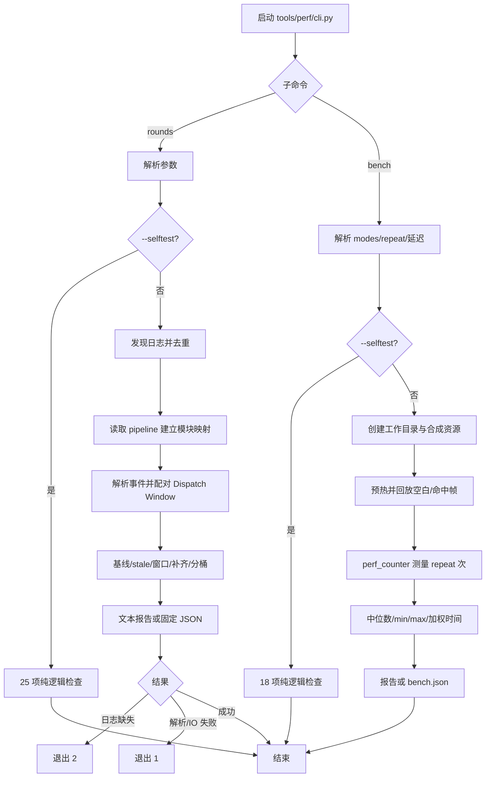

# tools/perf 程序流程

## 总流程

## 入口

`python tools/perf/cli.py rounds ...` 和 `python tools/perf/cli.py bench ...`
由顶层 CLI 派发。派发层临时替换 `sys.argv` 调子模块 `main()`，在 finally 中
恢复；未知子命令返回 2。

## rounds

1. `rounds_lib/cli.py` 解析日志、时间阈值、模块筛选、pipeline 目录、JSON
   输出和自检开关。
2. `scope.discover()` 展开文件/目录/通配；目录只收 `maafw*.log`。
   `dedupe_logs()` 按内容起点和文件大小去重，再按日志内容起点排序。
3. `scope.pipeline_nodes()` 读取 JSONC pipeline，建立节点到文件的映射；
   `module_scope()` 应用 `--module`。
4. `logs.load()` 解析 `OnEventNotify`、`EventDispatcher` 和 `NextList`，
   将 Starting/Succeeded/Failed 配对成 dispatch window；无法解析的行计 skipped。
5. `report.build_report()` 计算日志跨度、基线版本、stale 节点、窗口合并、
   超时剔除、模块过滤、缺失节点均值补齐和 0–4+ 分桶。
6. `report.print_report()` 输出统计和节点对账；`--json` 输出固定 schema，
   `tool` 字段保持 `tools/perf/lib/rounds.py`。
7. 日志缺失返回 2；解析或 IO 失败返回 1；基线缺失只写 reason。

## bench

1. 解析 modes、重复次数、延迟、工作目录和自检。
2. 自检模式只运行 18 项纯逻辑断言，不建资源、不连接设备。
3. 正常模式创建 `temp/perf/<timestamp>-<pid>/`，写合成 pipeline 和模板图，
   设置 Tasker log_dir/stdout_level。
4. 每个 mode 预热一次，再运行 repeat 次；FrameController 回放空白和命中帧，
   用 `perf_counter` 测量等待时间；截图不足时拒绝空白帧误命中。
5. 输出 ModeResult 的中位数、min、max，并按固定权重生成加权时间；可写
   固定 schema 的 `bench.json`。

## 不可改变的契约

- rounds/bench 子命令、参数、退出码和直跑入口不变。
- `Report.windows` 与 `Report.all_windows` 的对象别名关系不变；
  `impute_missing()` 的就地行为不变。
- JSON `tool` 字符串、bucket `4+`、`MAX_GAP_S=10`、`MAX_BUCKET=4` 和现有权重不变。
- selftest 不读取日志、不碰 git；bench selftest 不建资源、不连设备。
