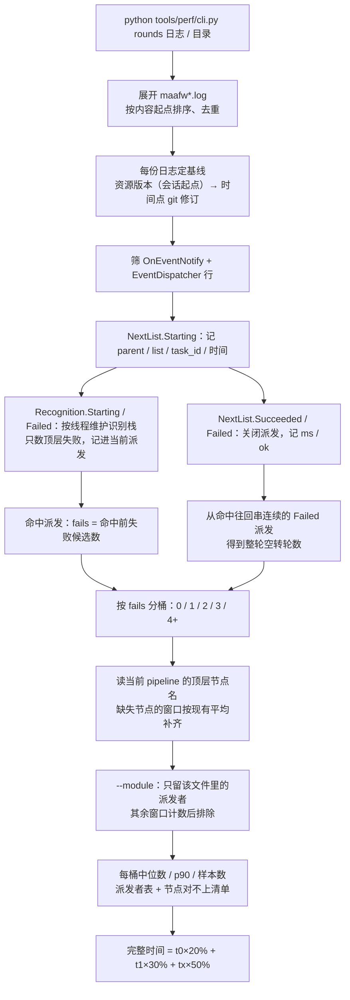
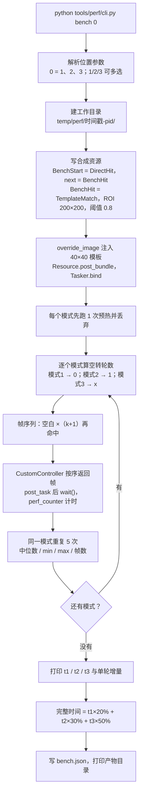
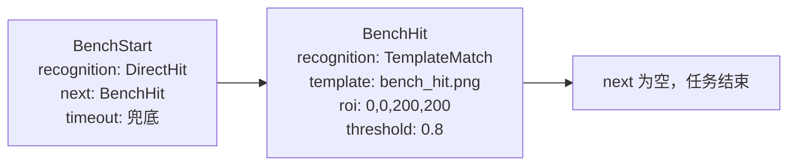

# tools/perf —— 口径与方法（methodology）

怎么算出来的、为什么这么算。用法见 [`../README.md`](../README.md)，踩过的坑见
[`pitfalls.md`](pitfalls.md)。

## 为什么合成基准不能直接当参考

同一台机器、同一天：

| 口径 | 0 个失败候选 | 1 个 | 2 个 | 加权 |
| --- | --- | --- | --- | --- |
| `bench`（合成） | 27 ms | 42 ms | 65 ms | 50 ms |
| `rounds`（今日 `debug/maafw.log`） | 116 ms | 768 ms | 4262 ms | 2385 ms |

三个原因：

- **`rate_limit` 被置 0**：默认 1000 ms/轮，真实等待的大头；`bench` 默认不等待。
- **识别是 40×40 模板**：真实 pipeline 里是 OCR / 自定义识别，失败候选 0.1–4 s，模板匹配只占几十毫秒。
- **截图是内存拷贝**：`CustomController` 直接返回 numpy 帧，真机 ADB 截图还要 50–300 ms。

另外，真实日志里「整轮空转后还能命中」的窗口几乎没有：今日日志 0 个，17 MB 备份里 3 个（最多 1 轮）。
`NextList.Failed` 大多以任务结束 / 超时收尾。真正占大头的是**一次派发里失败候选**，所以 `rounds`
按「命中前失败候选数」分桶；`bench` 仍保留原来的「整轮空转」口径，用于框架层比较。

判断「改 pipeline 有没有变快」「真机上一轮多久」用 `rounds`；`bench` 的数字不能当成真机一轮的时间。

## rounds 的解析口径

- 一次派发 = `Node.NextList.Starting` → `Succeeded` / `Failed`；耗时取两端时间差。
- 失败候选 = 该次命中里**顶层**的 `Node.Recognition.Failed`；`Or` / `And` 内部的嵌套失败不计。
- 整轮空转 = 连续的未命中 `NextList.Failed` 派发；往回串的间隔上限 10 s。
- `NextList.Failed` 也包含 `need_to_stop`（任务停止）那一种，所以「未命中轮」不等于「超时」。
- 同一事件在日志里有 `[msg=...]`（事件总线）与 `[message=...]`（agent sink）两行；只读前者，避免翻倍。
- 截断的行（证据包按块切过）跳过并计数；`--max-ms` 之外的挂起不计入中位数。

## 分桶与完整时间

按「命中前失败候选数」给窗口分桶（`0` / `1` / `2` / `3` / `4+`，`--x` 改第三个桶的桶名、`4+` 是合并桶），
每桶取中位数与 p90；`完整时间 = t0×20% + t1×30% + tx×50%`，权重是固定口径（`WEIGHTS`），
`--min-samples` 不够时不算。三桶里任一桶样本不足会说明缺哪个桶。

桶**不保证单调**：2 个失败候选的派发可能比 1 个的快（命中的候选是便宜 OCR）。



## 多份日志与「改过」标注

`maafw.log` 每次启动会被换名成 `maafw.bak.<换名时刻>.log`，文件名里的时刻是**下一次启动**
那一刻，不是日志内容的时间：本机 `maafw.bak.2026.11.05-00.03.35.605.log` 收的是 11-04 00:50 →
11-05 00:03 那段。所以传目录时按**内容起点**排序，重复的（同一份日志被拷过两份）按「内容起点
+ 文件大小」丢掉，日志行里给出真实时间跨度。

每份日志算一条基线，用来判断「统计出来的耗时还能不能代表现在的节点」：

1. 取会话**起点**生效的资源版本 `资源版本：vX.Y.Z`：优先日志自己那行；没有就找同装 MFA 界面
   日志（`<日志目录>/logs/log-*.log`、`<日志目录>/../logs/log-*.log`，`--mfa-log` 再补一个目录）。
   会话内版本变过就写「会话内变过 N 次」——本机 β52→β55、β63→β64 都发生在会话中间，
   一份日志一个版本不成立。
2. 版本取不到（日志被单独拷出来、或早于仓库历史）才退到「会话起点时 git 里 pipeline 的修订」，
   输出写「时间点」+ 短哈希。
3. 拿基线那一刻的节点定义和当前工作区逐节点比：不同就标「改」。只比定义，不比 diff 里的名字
   （文件重排不会把整份文件标上）；**只标注，不改数字**，派发者表里名字后面带「改」，末尾给
   一行「N 个派发者在日志之后改过」。

```
文件：D:\MaaAshArms\debug\maafw.log  派发 172（命中 163，未命中轮 1，剔除 >10000 ms 7）
      时间 2026-11-05 00:03 → 2026-11-05 00:37
      基线 v1.0.0-beta.65，MFA日志｜会话内变过 1 次
      改过 1 个派发者：TaskMaintenance（只标注，时长仍计入）
```

按本机安装目录（`D:\MaaAshArms\debug`，4 份、10-25 → 11-05）实测：1685 个窗口，
0/1/2 个失败候选的中位 **580 / 1397 / 2588 ms**，完整时间 **1829 ms**；四份日志的基线分别是
β52 / β55 / β64 / β65。仓库里 `debug/` 那两份合并是 383 个窗口、完整时间 1618 ms——t1/t2 的
中位都落在 1981 ms，因为 4 个已删节点的 50 个窗口按现有节点平均补齐后正好集中在这个值附近。

## 节点对不上时（新增 / 删除 / 改名）

日志是**当时**的 pipeline 跑出来的，现在的 `assets/resource/pipeline/` 可能已经改过。`rounds`
默认读当前 pipeline 的顶层节点名，只做**标记**，不改统计：

- **日志里有、当前 pipeline 没有**：按日志名保留在派发者表里，`当前` 列写 `否`；窗口**不排除**，
  但时长换成**现有节点窗口的平均值**（被替换的旧时长不参与这个平均），表里显示 `中位 X（原 Y）`。
  改名与删除在这里都显示为「没有」——日志里没有新旧名的对应关系，不猜。
- **当前 pipeline 有、日志里没派发**：不算错误，只统计个数；「新增」与「本次没跑到」在日志里分不开。
- **框架伪节点**（如 `@mse/action`）：`当前` 列写 `框架`，不算删除，也不参与「缺失节点」的补齐。

实测（17 MB 备份日志）：4 个派发者当前 pipeline 没有（`EscortBranchAccept`、`EscortClickDelivery`、
`EscortClickOk`、`ReturnMain`），共 50 个窗口，按现有节点的平均 2066 ms 计入；完整时间 1567 ms
（如果直接沿用旧时长是 1361 ms，两者差的就是补齐的影响）。`EscortBranchAccept` 的窗口最多（37 个），
仍按日志名排在表头，`中位 2066 ms（原 1890）`。

## 只看一个模块（`--module`）

`--module escort` 与 `--module escort.json` 等价：按 `pipeline/escort.json` 里的顶层节点名收窄窗口，
分桶、完整时间、派发者表都只算这个模块；多个模块用多次 `--module`。

- 归属只看**当前**文件里的节点名：别的模块的窗口被排除，个数会打印出来。
- 已从 pipeline 删除的节点归不到模块（日志里没有文件名），模块视图里同样排除——要看删除节点的
  平均补齐，就不带 `--module`。
- `--no-pipeline` 与 `--module` 互斥（没有节点表就定位不了模块）；模块名写错直接报错，不静默返回空表。

实测（17 MB 备份，`--module escort`）：49 个窗口，t0 / t1 / t2 = 134 / 678 / 763 ms，完整时间 612 ms，
另有 282 个窗口属于别的模块；不带 `--module` 的整份日志是 331 个窗口、完整时间 1567 ms。

## 合成基准（bench）的构造

三种模式用同一条两节点任务，只改喂进去的帧序列：

| 模式 | 空转轮数 k | screencap 顺序 | 预期帧数 |
| --- | --- | --- | --- |
| 1 必定命中且瞬间触发 | 0 | 空白 → 命中 | 2 |
| 2 next 空转 1 轮 | 1 | 空白 → 空白 → 命中 | 3 |
| 3 next 空转 x 轮 | x | 空白 ×(x+1) → 命中 | x+2 |





- 第一张帧给 `BenchStart`（`DirectHit` 不依赖画面），之后 `NextList` 每轮取一张；第 `k+1` 张命中。
- 帧数少于 `k+2` 说明空白帧被误判命中，本次计时无效，脚本直接报错。
- `timeout` 设在**派发者** `BenchStart` 上；`BenchHit.timeout` 管不到 B 的派发。
- 模板是 40×40 双色块（左红右黄），命中帧里贴在 `(100,100)`。
