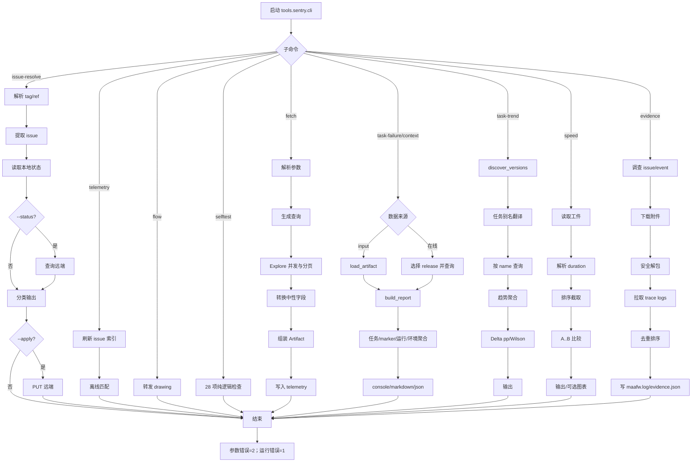

# tools/sentry 程序流程

## 总流程

## 入口与公共派发

`python -m tools.sentry.cli <子命令>` 进入 `cli.py`。
入口先配置标准输出和错误流，再由 `REPORTS` 延迟导入对应的
`lib/<module>.py:main`。报告命令使用
`temp/telemetry/report.lock`。参数错误返回 2，运行错误返回 1。

## 报告流程

### fetch

1. 解析 target、period、preset 或手工 fields。
2. `preset_queries()` 生成查询。
3. `explore_all()` 并发执行查询，并负责游标分页和重复游标保护。
4. `to_neutral_rows()` 将 Sentry 字段转换为工件中性字段：
   `span.description`→`description`、`span.status`→`status`、计数列转换为
   `_count` / `_count_user`。
5. 组装 schema 1 `Artifact`，写入 `temp/telemetry/`。

### task-failure / context

- 离线：`load_artifact()` → 按 release 推断目标版本 → `build_report()`。
- 在线：选择最新 release，查询任务、状态、运行和环境数据。
- `build_task_rows()` 将正常任务与仅失败时上报的 marker 分开。
- `build_release_rows()` 计算运行失败率，`build_context_rows()` 聚合环境。
- 输出层支持 console、markdown、json；JSON 字段由 dataclass 契约决定。

### task-trend

1. `discover_versions()` 按数据量选择版本，再按版本号展示。
2. `task_alias_map()` 从 `assets/interface.json` 建立 `name`、`label`、
   `entry` 到遥测 name 的别名。
3. 将 `--task` 翻译为遥测 name，再拼 `span.description` 查询。
4. `build_trend_rows()` 聚合成功、失败、取消，计算 Δpp 和 Wilson 区间。
5. 输出趋势明细；版本选择失败时明确报错。

### speed

读取 `fetch` 工件中的速度 measurement，解析 duration、release 和任务名；
排除系统 span，排序并截取版本，按 `A..B` 比较两端。
两端样本都达到门槛时才输出方向；`--chart` 延迟写 PNG。

### evidence

调查 issue/event → 枚举事件附件 → 安全下载解包 → 拉取 trace logs → 去重排序
→ 写 `debug/maafw.log` → `reconcile_written()` 对齐清单和磁盘
→ 写 schema 1 `evidence.json`。单附件失败只标记 `attachment_failed`。

### issue-resolve

解析 tag、pre-push ref 或手动 tag 范围 → 从提交正文提取
Fixes/Closes/Resolves → 合并显式 issue → 读取本地状态。
只有 `--status` 联网查询，只有 `--apply` 写远端；hook 不阻断 push。

### telemetry / flow / selftest

`telemetry` 刷新本地 issue 索引并支持离线匹配；`flow` 转发到 drawing；
`selftest` 按固定 CHECKS 顺序运行 28 项纯逻辑检查。

## 不可改变的契约

- CLI 子命令、参数、退出码、报告 JSON 字段和工件 schema 1 不变。
- `report_common`、`telemetry_index` 的跨工具导出保持原导入路径。
- `explore()` 返回中性字段；release 解析取双 `@` 中最后一个版本匹配。
- Sentry/git 不可用时不阻止本地绘图；单附件失败不废整包。
